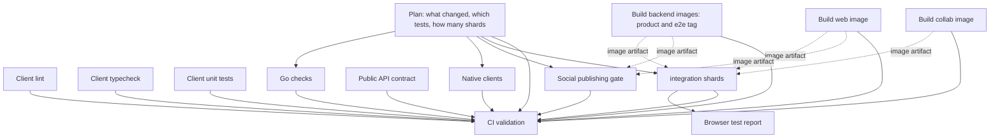

# The CI pipeline

[`.github/workflows/ci.yml`](../.github/workflows/ci.yml) is the whole
pull-request and push pipeline. This page explains why it is shaped the way it
is, so a change to it can be judged against the constraints it was built for.

The design rule is one sentence: **build each thing once per run, in parallel,
and gate the merge on all of it.**

## What it looks like

The dotted edges are not `needs:`. A browser shard starts immediately and
waits for each image by artifact ([`dev/ci-image.cjs`](../dev/ci-image.cjs),
through the [`load-ci-image`](../.github/actions/load-ci-image/action.yml)
action), so its checkout, dependency install, browser download and the whole
stack bring-up overlap the builds instead of queueing behind them.

## Build once, load everywhere

Every image the stack needs is built in exactly one job, with a layer cache,
and handed over as a run artifact named with the exact commit SHA:

| Image                                   | Built by             | Loaded by              |
| --------------------------------------- | -------------------- | ---------------------- |
| `screenshot-studio:<sha>`               | Build web image      | browser shards, gate   |
| `screenshot-studio-backend:local`       | Build backend images | browser shards         |
| `screenshot-studio-backend:social-gate` | Build backend images | social publishing gate |
| `screenshot-studio-collab:local`        | Build collab image   | browser shards         |

A consumer sets `STUDIO_PREBUILT_IMAGES=true`, which tells
[`dev/studio`](../dev/studio) to start Compose without `--build` and to skip
the container-side `npm ci`. Shards previously built the Go tree and the dev
web image themselves, uncached, once per shard: three full dependency installs
and three cold compiles per shard, which was roughly a third of the run's
entire runner budget and the reason the job had to delete 30 GB of preinstalled
toolchains to fit on disk.

A pull request reads the shared Docker layer caches but never writes them, so
one pull request cannot seed another's build. Keep that invariant.

## One browser lane

The suite runs against the production image only. The hooks that once required
a second `next dev` lane are asked for explicitly through `PLATFORM_E2E_HOOKS`
and [`lib/e2e-hooks.ts`](../clients/apps/web/lib/e2e-hooks.ts), which grants
them only to a production build serving a loopback origin. The flows the
production build genuinely fails are tagged `@quarantine` and run nightly;
[the suite's README](../clients/apps/web/test/e2e/README.md) is the reference.

## What runs, and when

[`dev/e2e-plan.mjs`](../dev/e2e-plan.mjs) classifies the change and emits the
shard matrix. Its rules, and the escalation list that keeps selection safe, are
covered by `clients/apps/web/test/e2e-plan.test.ts`. Area filters in the `Plan`
job skip the Go checks and the native clients when nothing they can observe
changed, and skip the social gate on a prose-only pull request.

Shards are packed by measured duration from
`clients/apps/web/test/e2e/durations.json`, refreshed by
[the nightly workflow](../.github/workflows/nightly.yml). Without a current
manifest the plan falls back to Playwright's `--shard`, which balances by file
count; one measured run's shards then came out at 904 s, 1044 s and 1464 s.

`E2E_SHARDS` at the top of the workflow is the wall-clock knob. Each shard runs
its own stack on its own runner with 4 Playwright workers, so raising it trades
concurrent job slots (20 on the Free plan, which this pipeline already uses
most of at peak) for a shorter critical path. Raising it stops helping once the
web image build, not the tests, decides the wall clock.

## One required check

`CI validation` is the only required status context on develop and main. It
lists every job in `needs`, asserts each result, and accepts a `skipped` job
only when the `Plan` job recorded the reason. Before this, it required the
client checks and the web image alone, so a pull request could merge into
develop with the Go suite, the API contract gate, the native clients, the
social gate and the browser tests all red.

Adding a job means adding it to `validate.needs`. A job that is not named there
does not gate anything.

## Release pull requests

A release pull request from develop into main re-tests the exact tree the push
to develop already tested. The `Plan` job looks for a successful push run on
the same head SHA and reuses its result rather than running a second full
suite.
