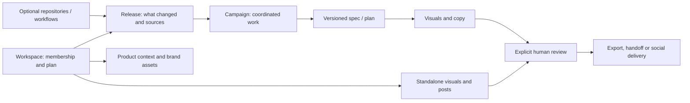

# Shots web usability audit and implementation plan

**Audit snapshot:** `develop`, `89591eaf4012dffa0cdf79b61b086af33ebb8918`, inspected on 2026-11-19/20 (America/New_York/UTC). Primary scope: `clients/apps/web`; shared packages and Go were followed where needed to explain web behavior. **Disposition at audit time: planning only.** Subsequent implementation was authorized separately and is tracked in the [implementation record](web-usability-implementation.md); the findings below retain their original audit snapshot.

## 1. Diagnosis and evidence boundary

Shots has useful, connected foundations: a shared application shell, native editors, saved documents, campaign stages, permission checks, explicit post review, and guarded publishing. The evidence does **not** support a wholesale rewrite. The strongest problems are specific breaks in trust and continuity, combined with a product experience still centered on producing visuals and social posts while the company direction centers on preparing a meaningful release for its audiences.

The first priorities are:

1. **Make approval mean an explicit review decision.** Onboarding confirms product-profile fields, then approves a newly generated spec and plan without showing either to an authorized reviewer. Server authorization works; the client invokes the authorized decision at the wrong point in the experience.
2. **Protect unresolved edits.** A targeted hook test reproduced a conflict state in which local text exists only in memory, the save state is `saved`, and subsequent leave/save checks succeed. A full reload can discard that conflict copy without the hook requesting an unload warning.
3. **Connect a real release to the work that follows.** The release inbox opens useful source evidence, but its detail page offers Workflows and screenshot editing rather than a direct route to create or resume a campaign for that release. The current new-campaign form creates another release.

These are stronger grounds for action than a general claim that the app is confusing. Revenue, retention, and abandonment effects remain hypotheses. No customer funnel, paid-pilot results, or representative support corpus was available for this audit.

### Method and coverage

- Read root/web instructions, `feature-flow` and its review-team reference, the product direction, RFC index, README roadmap, Playbook Core, backend architecture, and prior UX plans before reviewing implementation.
- Inspected the worktree first. The only existing tracked modification was five lines in `clients/apps/web/test/e2e/social-scheduling.spec.ts` that dismiss an account-action dialog after OAuth. It is unrelated and was preserved.
- Refreshed the code-review graph to the snapshot SHA, then used semantic search and callers/importers/test relationships. Followed critical paths into source, SDK methods and Go decision/history code. An absent graph test edge was not treated as absent coverage.
- Inventoried **148 page modules, 5 layout modules and 282 route-handler modules** under `app`. These are source-module counts, not 148 unique product tasks or 282 user screens. Dynamic routes, aliases, marketing pages and render endpoints are included. The map below groups the full route surface; detailed behavioral inspection concentrates on the critical journeys.
- Ran **83 existing focused tests: 83 passed, 0 failed, 0 skipped**, plus one audit-only hook reproducer that confirmed the conflict condition. These tests are local evidence, not deployed or customer evidence.
- Tried the existing authorized browser session. The Opera connector required reauthorization; browser-tab automation was unavailable. Native Chrome exposed an existing Shots tab and an initial accessibility tree. Later navigation did not yield reliable updated content, and the screenshot was unusable. No usable current visual evidence or completed end-to-end journey was obtained. This is an access/capture limitation, not a diagnosed Shots rendering bug.
- A narrow connected GitHub search found roadmap work, including [pilot measurement #419](https://github.com/PlaybookMediaLLC/shots/issues/419), [assisted pilots #420](https://github.com/PlaybookMediaLLC/shots/issues/420), [release qualification #421](https://github.com/PlaybookMediaLLC/shots/issues/421) and [claim review #425](https://github.com/PlaybookMediaLLC/shots/issues/425). Those are planning inputs, not customer evidence; issue status was not established. Narrow public Slack searches for Shots plus confusion/onboarding returned no results. That does not establish the absence of complaints.

**Evidence labels:** **C** = confirmed in current source or a focused local reproduction; **H** = a usability/business hypothesis grounded in source; **U** = unverified runtime/customer behavior. A C finding does not imply its customer frequency is known. Browser reproduction instructions below are procedures to run, not claims that they ran successfully in this audit.

### What already works and should be preserved

| Foundation                             | Current evidence                                                                                                                                                                                                                                       | Implication                                                                                                                                             |
| -------------------------------------- | ------------------------------------------------------------------------------------------------------------------------------------------------------------------------------------------------------------------------------------------------------ | ------------------------------------------------------------------------------------------------------------------------------------------------------- |
| Stable areas and navigation vocabulary | [Navigation registry](../../clients/apps/web/lib/platform/navigation.ts#L5) owns destinations, tools, aliases, subnavigation and plan-aware behavior.                                                                                                  | Extend this owner; do not add another sitemap configuration or rebuild the shell.                                                                       |
| Campaign progress and review           | [PipelineSteps](../../clients/apps/web/components/launch/PipelineSteps.tsx#L52) distinguishes spec, plan, production, review, versions and failures.                                                                                                   | Use these stages for onboarding and release continuation.                                                                                               |
| Short manual campaign setup            | [CampaignSetupForm](../../clients/apps/web/components/campaigns/CampaignSetupForm.tsx#L126) supports a title plus benefit or source, optional product setup, validation, dirty-state protection and stable keys during that form session.              | Keep a complete manual path; do not require GitHub, capture, AI or seven posts. Its key pattern is useful but does not by itself solve reload recovery. |
| Save and conflict handling             | [Draft hook](../../clients/apps/web/components/write/composer/useDraftDocument.ts#L145) already drains edits, retries eligible save failures and avoids overwriting newer versions; conflict UI offers recovery.                                       | Fix the uncovered conflict lifetime/leave condition inside the existing owner.                                                                          |
| Scoped, bounded recents                | [work.ts](../../clients/apps/web/components/platform-hub/work.ts#L45) uses authorized lists, bounded parallel reads, partial-error reporting and a shared query key.                                                                                   | Extend coverage carefully; keep limits and tenant-aware cache keys.                                                                                     |
| Store workspace persistence            | [LocalStoreProjects](../../clients/apps/web/components/platform-hub/LocalStoreProjects.tsx#L39) separates workspace copies and browser-only projects; [workspace.ts](../../clients/apps/web/lib/store-screenshots/workspace.ts#L12) records revisions. | Do not implement cloud saving again. Correct stale entry-point wording.                                                                                 |
| Authorization and data ownership       | [page-access](../../clients/apps/web/lib/auth/page-access.ts), [access](../../clients/apps/web/lib/auth/access.ts), [backend SDK bridge](../../clients/apps/web/lib/backend/sdk.ts), [backend architecture](../../server/README.md).                   | Preserve the session/permission/tenant path through SDK to Go. No web database queries.                                                                 |
| Checkout continuity                    | [Checkout return](../../clients/apps/web/app/api/billing/checkout/return/route.ts) and passing `billing-checkout-return.test.ts`.                                                                                                                      | The older lost-return finding is not a current recommendation. Still exercise payment return in deployed validation.                                    |
| Performance safeguards                 | [Request-scoped SDK read sharing](../../clients/apps/web/lib/backend/sdk.ts#L49) and bounded parallel recent-work reads.                                                                                                                               | Repeated source-level reads in a layout and page are not proof of duplicate backend requests. Measure before adding caching.                            |

## 2. Product direction versus the current app

The [company brief](../company.md), [vision](../vision.md) and [README roadmap](../../README.md#roadmap) describe a release-readiness product for software teams: identify a meaningful change, establish accurate facts, prepare materials for relevant audiences, obtain human approval, deliver them, and learn whether they were used. Product marketing/release owners coordinate; engineers provide evidence; reviewers approve; sales, success and other audiences consume the result. These are intended roles, not verified customer segments from this audit.

| Source or capability                                                                      | Status at this snapshot                                                                                                                                                                                                           | How this plan uses it                                                                                                                         |
| ----------------------------------------------------------------------------------------- | --------------------------------------------------------------------------------------------------------------------------------------------------------------------------------------------------------------------------------- | --------------------------------------------------------------------------------------------------------------------------------------------- |
| [RFC execution order](../rfcs/README.md)                                                  | 001 pilot measurement continues across 002 qualification → 003 claims → 004 kits/readiness → 005 handoff/use → 006 freshness.                                                                                                     | Keep this sequence for new product capabilities. Usability/reliability repairs do not require completing every milestone.                     |
| Existing intake, campaigns, specs/plans, drafts, approvals, exports, social publishing    | Present in routes and implementation.                                                                                                                                                                                             | Reuse them for an assisted first release and maintain existing customers' workflows.                                                          |
| Qualification, stable verified claims, exact-version kit readiness, audience-use evidence | Described as proposed in the RFC index. Current release/detail and campaign UI does not provide the complete promised sequence. Focused source searches did not establish an implemented qualification/claim-verification domain. | Treat these as roadmap gaps, not a cosmetic rename or completed functionality. Revalidate each slice against current work before starting it. |
| [October IA redesign](ux-information-architecture-redesign.md)                            | Historical audit/proposal with screenshots from another snapshot.                                                                                                                                                                 | Reuse its five work areas and separation of scope, revision, review and delivery. Its observations are not current runtime evidence.          |
| [IA implementation record](ux-information-architecture-implementation.md)                 | Records local implementation and tests, explicitly separates deployment. Many navigation/handoff changes are now present.                                                                                                         | Close or reconcile old items; do not restart that backlog.                                                                                    |
| [October 28 journey audit](ux-journeys-2026-10-28.md)                                     | Useful prior fixes and remaining issues, some now superseded.                                                                                                                                                                     | Rechecked current source. Checkout return and Store cloud persistence should not be reproposed.                                               |
| Recent shell/editor work                                                                  | Recent commits include rem-based 80% shell sizing, shared recents/search, in-app image tools and editor updates. Current icons use Phosphor, not the older proposal's icon choice.                                                | Avoid a competing redesign. Assess the current scale and flow; no icon migration.                                                             |
| Authorized parallel product lines                                                         | RFC index includes Code Studio, scoped social scheduling/analytics, post management and voice capture amendments.                                                                                                                 | Preserve these. Release readiness does not authorize deleting writing, creative, Store, publishing or supported integration work.             |
| Automated capture                                                                         | Conditional supporting work with scoped recovery amendments.                                                                                                                                                                      | Manual source links/uploads remain a first-class path. Capture setup is not a prerequisite for a usable release.                              |

The three problem classes need different responses:

- **Product scope:** onboarding and Home favor generic content generation; release-readiness guarantees remain incomplete. Resolve with a clear first outcome, assisted pilots and the existing RFC sequence.
- **Information architecture/interaction:** release-to-campaign continuation, retrieval destinations, ambiguous status scope and storage labels can mislead. Resolve in existing screens and navigation owners.
- **Software architecture:** browser-owned launch sequencing, lost recovery state and error-to-empty coercion produce specific user-visible problems. Resolve those boundaries. File size or duplicate-looking code alone does not establish user harm.

## 3. Current product and journey map

### Route and layout inventory

Paths omit the locale prefix. The registry and access checks determine which entries a particular role, plan and rollout flag can use. Root/locale layouts provide providers and page structure; the `(editors)` group wraps editor experiences, the screenshot editor has a nested handoff layout, and campaign detail has its own persistent subnavigation. Public pages and renderer routes are not normal sidebar destinations.

| Area and routes                                                                                                                                                 | User, task and entry                                                                                                                                                  | Objects/states to understand                                                                          | Completion and next step                                                                                                                         |
| --------------------------------------------------------------------------------------------------------------------------------------------------------------- | --------------------------------------------------------------------------------------------------------------------------------------------------------------------- | ----------------------------------------------------------------------------------------------------- | ------------------------------------------------------------------------------------------------------------------------------------------------ |
| `/sign-up`, `/sign-in`, `/two-factor`, `/accept-invitation`, `/onboarding`, `/onboarding/plan`, `/onboarding/product`                                           | New member or workspace owner enters from public site/invitation. Establish identity, workspace, entitlement and product context.                                     | Session, active workspace, membership, plan, profile extraction/manual fields, background run.        | Current owner path can generate seven campaign posts; other roles/flags branch to the app. F01/F03/F05 affect this path.                         |
| `/`, `/home`                                                                                                                                                    | Returning member starts or resumes work. Home provides role-aware starters, recent work, attention and queue cues. Legacy editor queries retain a compatibility path. | Workspace, permissions, paid features, recent document types, post queue.                             | Open a document, start a visual/post/campaign or set up automation. Release progression is not the organizing frame.                             |
| `/create`, `/create/code[/id]`, `/create/tweet`, `/create/tools[/tool]`, `/create/voice`                                                                        | Designer, writer or developer starts visual/code/media/voice work.                                                                                                    | Tool versus saved object, local versus workspace storage, feature flags.                              | Save/export or send to Publish; voice/code stay available where enabled.                                                                         |
| `/editor`, `/canvas`, `/canvas/new`, `/canvas/[id]`, `/creative-sets[/id]`, `/create/store/[[...project]]`                                                      | Visual creator edits a screenshot project, canvas, Story Set or Store project.                                                                                        | Document identity, unsaved/saving/saved/conflict, artboard/device/format, source lineage, export.     | Reopen in native editor, export precise output, attach or create a post through existing handoffs. Do not flatten these into one document model. |
| `/campaigns`, `/campaigns/new`, `/campaigns/[id]/{spec,plan,assets,copy}`                                                                                       | Release owner/writer/reviewer organizes a launch and reviews generated work.                                                                                          | Campaign, linked release, spec and plan versions, runs, creative assets, post revisions, approvals.   | Spec → plan → production → copy review → delivery. Overview already supplies stage-specific actions.                                             |
| `/campaigns/releases`, `/releases/[id]`                                                                                                                         | Owner inspects intake/source evidence, including releases without a campaign.                                                                                         | Release brief, source URLs, capture assets, Draft/Ready/Archived/Cancelled.                           | Current detail supports source reading and screenshot→post; campaign continuation is missing (F04).                                              |
| `/campaigns/deliveries`, `/publish`, `/publish/[draftId]`, `/publish/calendar`                                                                                  | Writer/social operator finds, reviews, schedules and tracks posts.                                                                                                    | Publishing profile, draft/document, channel variants, review eligibility, schedule, delivery receipt. | Publish/schedule or recover a blocked/uncertain delivery. Editorial approval, schedule and provider result remain separate.                      |
| `/publish/batches[/id]`, `/publish/analyze`, `/publish/analyze/{observations,posting-times}`, `/publish/link-checks`                                            | Experienced operator does bulk work, reads supported analytics or checks links.                                                                                       | Batch, account/profile scope, provider availability, measured versus suggested results.               | Return to posts/calendar; these tools need not be first-run prerequisites.                                                                       |
| `/library` with `type=canvas/story/store/code`, `view=assets/brand`                                                                                             | Creator retrieves saved visuals and reusable resources.                                                                                                               | Native project versus immutable asset versus brand asset; browser/workspace copy.                     | Open the owning editor or reuse an asset. Posts are found in Publish, not Library.                                                               |
| `/workflows/overview`, `/workflows`, `/workflows/new`, `/workflows/[id]`                                                                                        | Workspace administrator configures repeatable intake/production.                                                                                                      | Definition, draft/active version, trigger, execution, credits and approval controls.                  | Validate/save/enable and inspect the resulting run. Optional setup rather than the only release entry.                                           |
| `/workflows/sources`, `/workflows/sources/[id]/production`, `/workflows/runs[/id]`, `/workflows/deployments`, `/workflows/connections`                          | Admin connects repositories/hosts/capture and diagnoses failures.                                                                                                     | Repository admission mode, source event, execution status, credentials/capture access.                | Open produced release/campaign, retry only eligible work, reconnect with scope intact. F05/F06 affect overview feedback.                         |
| `/activity`                                                                                                                                                     | Any permitted member reconstructs workspace activity.                                                                                                                 | Actor, time, changed object and event type.                                                           | Open the actual work item; history is not a task queue or proof of audience adoption.                                                            |
| `/settings/[[...section]]`, `/settings/profile`, `/upgrade`, `/pricing`                                                                                         | Members manage account preferences; authorized owners/admins manage team, profiles/connections, product/brand context, billing and enterprise controls.               | Personal versus workspace versus publishing-profile scope, role, entitlement and usage.               | Save with existing dirty guards, return to task; keep upgrade and insufficient-permission explanations distinct.                                 |
| `/founder-hub/{manage,consent}`, `/oauth/authorize`, `/integrations/social/[provider]/complete`                                                                 | Explicit integration connection/consent and OAuth return.                                                                                                             | Requested scope, selected identity/workspace, pending connection intent.                              | Return to the originating setup/task. Never create an alternate authorization path to shorten this flow.                                         |
| `/d/[token]`, `/s/[token][/embed]`, `/review/[token]`, `/p/[slug]`, `/analytics/public/[token]`                                                                 | Guests/reviewers or recipients consume shared work.                                                                                                                   | Link audience/access, version, comment/review versus editing rights.                                  | Review/comment/view within the issued access, not general workspace access.                                                                      |
| `/drafts[/id]`, `/drafts/calendar`, `/drafts/settings`; public `/code`, `/tweet`, `/store-screenshots`; root editor-query compatibility                         | Existing bookmarks, public acquisition and older naming.                                                                                                              | Public utility versus signed-in task, alias/deep-link context.                                        | Preserve existing handlers/redirects, IDs and query/hash semantics; do not remove routes during a label change.                                  |
| `/landing`, product/feature/solution/use-case pages, `/for`, `/tools`, image/video conversion pages, docs/developers/API reference, pricing/contact/legal pages | Prospects and integration developers learn or use public utilities.                                                                                                   | Public promise, sign-in, tool versus workspace feature.                                               | Clear entry to app with intended task retained. Marketing claims require separate promise review as readiness milestones ship.                   |
| `/render/*`, API handlers and `.well-known` metadata                                                                                                            | Renderer, API clients and integrations, not primary human navigation.                                                                                                 | Authenticated contracts, identifiers and render/export semantics.                                     | Keep stable contracts and noninteractive behavior; do not expose operational endpoints as menu items.                                            |

### Core concepts and relationships



The diagram shows the reusable current path, not a completed release-kit system. Product profile describes the product; a release describes a specific change. A publishing profile groups social identity/settings; a brand kit controls visual/voice defaults. A campaign coordinates work; a saved post or visual can also exist without one. A source event/run reports automation, not user approval. These distinctions should appear in relevant screen descriptions rather than a required vocabulary lesson.

### End-to-end journey assessment

All rows are source/test assessments unless explicitly marked otherwise. Real keyboard, screen-reader, touch and browser-back behavior remains U.

| Journey                         | Current path and what works                                                                                                                                    | Friction, recovery and constraints                                                                                                                                                                                                               | Required validation                                                                                                                                                                                                  |
| ------------------------------- | -------------------------------------------------------------------------------------------------------------------------------------------------------------- | ------------------------------------------------------------------------------------------------------------------------------------------------------------------------------------------------------------------------------------------------ | -------------------------------------------------------------------------------------------------------------------------------------------------------------------------------------------------------------------- |
| Signup → first useful result    | Authentication → workspace → plan → product. URL extraction has a manual fallback, field review, progress and error actions. Non-managers are sent to the app. | A plan is required before credit-consuming extraction; necessity/conversion impact is unmeasured. Profile confirmation triggers hidden approvals and a tab-dependent seven-post sequence (F01/F03). Read failures can look like new setup (F05). | New owner and invited member; extraction timeout; manual entry; paid/no-plan; feature off; lost reply; close/reload; explicit review. Measure a meaningful saved/reviewed result rather than generation count.       |
| Home → start/resume             | Role-filtered starters, shared search, recent documents, attention, visible plan markers.                                                                      | Recent coverage excludes release/campaign and several saved types; post footer points to Library (F07). Post-volume nudge may be wrong for infrequent release teams (F09).                                                                       | Resume each supported type; empty/partial-error; workspace switch; plan/role changes; mobile/keyboard search and next-action comprehension.                                                                          |
| Release intake → campaign       | Manual brief is short; repository intake and release evidence exist; screenshots retain a source-aware editor handoff.                                         | Inbox/detail has no direct campaign continuation; new form creates a release again (F04). Capture/workflow setup should remain optional.                                                                                                         | Release with/without assets, existing linked campaigns, archived release, read-only member, tenant mismatch, disabled campaign flag; Back and direct links.                                                          |
| Create/edit/save/find a visual  | Existing native editor/project/library patterns and export pipeline preserve document type. Store now supports workspace copies and local drafts.              | Storage copy is stale at Create/Home (F08). Recent/search does not cover every saved kind. Full export geometry and local recovery were not rerun.                                                                                               | Save/reload/open on second device, browser-only labeling, blocked storage, deleted assets, revision conflict, export dimensions, keyboard focus and mobile panels.                                                   |
| Write/edit/save/find a post     | Draft ownership, autosave, revision checks, offline/error states, local conflict recovery UI and navigation flush exist.                                       | Hook-level reproduced hard-navigation conflict gap (F02). A server save and an unresolved local alternate are different states.                                                                                                                  | Concurrent edits, reload, browser Back, switching draft/workspace, revoked permissions, 403/404/409/429/5xx, slow/in-flight saves and recovery controls.                                                             |
| Review/approve/export/handoff   | Existing spec/plan versions, campaign post transitions, sharing and delivery controls. UI already distinguishes many scheduling blockers.                      | Onboarding misuses the approval command (F01). Current approval is not full claim verification or kit readiness. Customer-facing audience-use evidence is a roadmap gap.                                                                         | Explicit authorized decision, stale version, edit after approval, archive, guest limits, unsupported export, missing asset/channel; verify audit record and persisted revision.                                      |
| Schedule/publish/recover        | Profiles, channels, calendar, delivery state and safe-provider rules are already implemented.                                                                  | Live provider behavior not certified. “Planned,” “Approved,” “Scheduled,” “Sent to app” and actual delivery must remain distinct. No evidence here warrants another scheduler.                                                                   | Failed/revoked connection, uncertain delivery, stale queue slot, timezone/DST, approval invalidation, permission loss, mobile schedule discoverability. `UNKNOWN_DELIVERY` must not trigger a blind retry.           |
| Connect integration → return    | Existing connection UI provides provider availability, selection/reconnection, error/retry and scoped OAuth intent.                                            | Automate misreports some loading/error states as absence and mixes run-count scopes (F05/F06). Runtime reconnect not exercised.                                                                                                                  | Successful/cancelled/failed OAuth, wrong workspace/profile, duplicate callback, provider unavailable, revoked credential, return to original task; no actual outbound publish required for connection UI validation. |
| Team/settings/billing           | Grouped/searchable settings, scoped role checks, save guards and checkout return context exist.                                                                | Breadth is a complexity hypothesis, not proof that all settings are poorly designed. Billing failure can route to apparent product setup (F05).                                                                                                  | Account/workspace/profile scope, dirty Back, removal/revocation, denied changes, checkout cancel/success, changed entitlement; test exact return target without widening permission.                                 |
| Return later → decide next step | Campaign stages, activity, recent work and automation statuses expose progress.                                                                                | Home centers documents/queue more than a real release's outstanding review; status scope errors damage confidence (F06/F09).                                                                                                                     | A second visit with mixed completed/failed/blocked work; user identifies next action and responsible person without assistance. Future freshness requires evidence, not elapsed age alone.                           |

## 4. Prioritized findings

Priority is ordinal, not a fabricated quantitative score. **P1** protects decisions, work or a core path; **P2** removes misleading feedback/discovery friction; **P3** requires validation before a larger change. Reach and frequency describe triggering conditions, not measured incidence. Effort: **S** = a focused change; **M** = several connected owners/tests; **L** = multiple independently delivered slices. Estimates remain uncertain until implementation traces the then-current callers.

| ID  | Priority / evidence         | User harm and journey                                                                                   | Reach and frequency condition                                                                           | Confidence / effort / dependency                                                             |
| --- | --------------------------- | ------------------------------------------------------------------------------------------------------- | ------------------------------------------------------------------------------------------------------- | -------------------------------------------------------------------------------------------- |
| F01 | P1 / C                      | Profile confirmation approves unseen generated spec/plan; review history overstates the decision made.  | Campaign-enabled onboarding by a member with `release:approve`; runs that return results.               | High / S–M / explicit existing review pages.                                                 |
| F02 | P1 / C + local reproduction | Unresolved local conflict can be lost on hard navigation; saved status is incomplete.                   | Writers encountering a conflicting save then leaving/reloading.                                         | High for hook behavior; browser incidence U / S–M / existing hook and leave guards.          |
| F03 | P1 / C, failure incidence U | Onboarding progression depends on the tab; retry can create another release/campaign.                   | Interrupted first-campaign creation/generation, lost replies and repeat confirmation.                   | High for mechanism / M / simplify F01 flow first.                                            |
| F04 | P1 / C flow gap, H impact   | Existing release cannot directly start/resume its campaign from detail; users must reconstruct context. | Release-inbox users, especially releases with no screenshot handoff.                                    | High source, medium usability / M / existing release/campaign contracts.                     |
| F05 | P2 / C                      | Errors become “not configured” or fresh onboarding; encourages incorrect setup work.                    | Profile read failure; capture/host request pending or failed.                                           | High / S–M / existing error/empty patterns.                                                  |
| F06 | P2 / C                      | Automate counts one mode while Latest runs includes both modes; “None yet” can coexist with runs.       | Workspaces with legacy intake runs, especially no new automation runs.                                  | High / S / decide the displayed scope explicitly.                                            |
| F07 | P2 / C + H                  | Recent/search lacks important saved types; “View all in Library” is wrong for posts.                    | Returning release owners/writers and users of Store/Story/Code; bounded lists can hide a selected type. | High scope/destination, medium impact / S footer, M coverage / reuse loader and owner lists. |
| F08 | P2 / C                      | Store entry points say browser-only despite implemented workspace saving.                               | Store users starting or finding work.                                                                   | High / S / copy only, retain actual scope labels.                                            |
| F09 | P2 experiment / H           | Home and seven-post onboarding optimize content production more than meaningful-release readiness.      | New release teams and infrequent shippers; frequency unmeasured.                                        | Medium / M pilot / F01/F04 and a small study.                                                |
| F10 | P3 validation / H           | Desktop root scale reduces already-small text and rem-based controls.                                   | Authenticated viewports at least 768px, including tablets.                                              | High CSS fact, impact U / S validation then bounded M fix / inspect actual rendered sizes.   |

### F01 — Separate profile confirmation from generated-work approval

**Affected task:** an owner confirms what the product does, expecting to review generated launch material afterward.

**Source/reproduction:** in [OnboardingProduct:165–186](../../clients/apps/web/components/auth/OnboardingProduct.tsx#L165), `startCampaign` → spec generation → `spec.approve` → plan generation → `plan.approve` → production run follows one profile confirmation. [The manual button:284–290](../../clients/apps/web/components/auth/OnboardingProduct.tsx#L284) says “Looks right”; the agent-review callback follows the same path. In a campaign-enabled workspace with approval permission, confirm the profile and inspect the generated spec/plan decision history before their pages have been shown. The current E2E onboarding flow expects seven posts after this confirmation; it does not establish an explicit spec/plan review.

**Root cause:** permission to approve is used as sufficient reason to approve automatically. [Launch router](../../clients/apps/web/lib/trpc/routers/launch.ts#L212) and [Go approval command](../../server/internal/product/launch.go#L314) enforce authority and record the approving actor. This is a misleading human-decision interaction, **not an authorization bypass or proof that posts publish automatically**.

**Correction/reuse:** confirmation saves product context; route to the existing campaign spec review with a clear next step. Each generated version needs its own explicit decision. Keep the existing copy/post review. **Acceptance:** confirming profile fields creates no spec/plan approval; authorized users approve the displayed current version; non-approvers get a review handoff; stale/revoked access rejects the decision; history distinguishes profile confirmation from approval. No historical approval is silently upgraded to verified facts.

### F02 — Keep the unresolved conflict inside the leave contract

**Affected task:** retain local writing after another writer or tab changes the same draft.

**Source/reproduction:** [useDraftDocument:36–48](../../clients/apps/web/components/write/composer/useDraftDocument.ts#L36) stores recovery copies in module maps. A 409 [reloads the server copy and reports saved:228–233](../../clients/apps/web/components/write/composer/useDraftDocument.ts#L228); replacement clears `dirty` at line 131. [The unload guard:355–362](../../clients/apps/web/components/write/composer/useDraftDocument.ts#L355) checks only dirty/in-flight. [Composer leave:378](../../clients/apps/web/components/write/composer/WriteComposer.tsx#L378) calls `flush`; a later flush succeeds because there is nothing dirty.

**Local result:** using the existing `write-autosave.test.ts` React/jsdom harness, mock save as 409 and reload as a newer version. Make a local title edit; the first flush rejects; conflict retains the local title and save state becomes `saved`; dispatching cancellable `beforeunload` leaves `defaultPrevented=false`; another flush resolves with the conflict still present. One test passed while asserting this undesirable current behavior. It is not an application fix. A real browser reload then destroys module memory; no browser-loss experiment was performed here.

**Correction/reuse:** make unresolved conflict part of the hook's save/leave contract and the composer's visible status until explicit restore/discard. Reuse the existing banner and controls. Define hard-reload behavior: first deliver a truthful leave warning; if the promise is recovery after a user proceeds or a browser kills the tab, add bounded, workspace-scoped recovery storage with deletion/revocation rules. A warning alone does not guarantee crash recovery. **Acceptance:** unresolved conflict never silently qualifies as safe-to-leave; later scheduling/sharing cannot bypass it by calling flush again; restore/discard resolves it explicitly; newer server content is never overwritten merely to dismiss a warning.

### F03 — Make first-campaign progress resumable and retries stable

**Source/reproduction:** [OnboardingProduct:97–104](../../clients/apps/web/components/auth/OnboardingProduct.tsx#L97) reconstructs profile review/manual state, not an in-progress campaign. Campaign ID and step are local state; [the browser polls/sequences work:138–194](../../clients/apps/web/components/auth/OnboardingProduct.tsx#L138) and asks to keep the tab open. [startFirstCampaign:76–93](../../clients/apps/web/lib/onboarding/first-campaign.ts#L76) assigns a new release idempotency key per call and creates the campaign without a stable key. Reload after a campaign is created or lose the mutation response, then confirm again: the path can issue new creation requests rather than resume the original work.

**Root cause/consequence:** durable individual jobs exist, but the user-visible sequence and creation identity are tab-owned. This risks duplicate work/credit use and an uncertain stopping point; real frequency and billing effects are unmeasured.

**Correction/reuse:** after F01, navigate to the persisted campaign as soon as it exists and use existing stage/run pages. Extend the existing command contract only for a stable first-campaign submission identity and recovery lookup if still needed. Reuse the key pattern in [CampaignSetupForm:89](../../clients/apps/web/components/campaigns/CampaignSetupForm.tsx#L89), with explicit reload/lost-response semantics; a component-state key alone is insufficient. Do not add another job engine. **Acceptance:** same submission retried after a lost response resolves to the same release/campaign; reload resumes persisted stage; an explicit new campaign remains possible; two tabs cannot silently create two first campaigns for the same submission; failures identify the saved work and an allowed next action.

### F04 — Continue from release evidence into its campaign

**Source/reproduction:** [ReleasePage:38–95](../../clients/apps/web/app/[locale]/releases/[releaseId]/page.tsx#L38) is read-only evidence with a Workflows header action. Its screenshot section offers editor→post, but there is no create/resume campaign action. Enter Campaigns → Release inbox → a release without screenshots. To start a campaign, go back to Campaigns → New; [CampaignSetupForm:168–186](../../clients/apps/web/components/campaigns/CampaignSetupForm.tsx#L168) creates a new release before creating its campaign. Current new-page input does not accept an existing release selection.

**Correction/reuse:** add an explicit “Create campaign from this release” action and related-campaign links; permit selecting an existing release in the existing form. Reuse the campaign `releaseId` contract and tenant-scoped release read. Keep screenshot handoff. **Acceptance:** opening an existing release and creating a campaign does not create another release or require retyping sources; existing campaigns are visible; multiple intentional campaigns remain supported; archived/no-permission/feature-off states explain the restriction; invalid/foreign IDs do not disclose data. Return/back stays in release context.

### F05 — Do not report failed reads as missing setup

**Source/reproduction:** [pathAfterPlan:15–17](../../clients/apps/web/lib/onboarding/next-step.ts#L15) catches any profile read failure as `null` and chooses product onboarding; its comment promises the opposite failure behavior. [Product onboarding page:44–47](../../clients/apps/web/app/[locale]/onboarding/product/page.tsx#L44) also turns failed profile/ICP/run reads into empty state. Separately, [AutomateOverview:29–30,73–84](../../clients/apps/web/components/workflows/AutomateOverview.tsx#L29) omits `capture.error` from failure handling and treats absent capture/host data as “Not set up”/“No hosts connected.” Trigger a 5xx/timeout or hold these reads while the rest of the page succeeds.

**Root cause/consequence:** success-empty, pending and failure share a value. Users may repeat setup or mistrust connections that still exist. This is not evidence that credentials were deleted.

**Correction/reuse:** preserve successful-null as “not configured”; show per-section pending/error with retry for failed reads. Use the existing Alert/Skeleton/Retry patterns. After checkout, preserve the validated return target or show recoverable unavailable context rather than infer an absent product profile. **Acceptance:** 404/known-null, 403, network/5xx, pending and success have defined distinct outcomes; no reset or creation occurs because a read failed; authorized retry recovers without re-entry.

### F06 — Give Automate counts and recent rows the same scope

**Source/reproduction:** [AutomateOverview:47–68](../../clients/apps/web/components/workflows/AutomateOverview.tsx#L47) counts `runCounts`; [Go overview:115–118](../../server/internal/product/release_automation_preview.go#L115) splits `legacyRunCounts` and automation `runCounts`. [recentRuns router:116–118](../../clients/apps/web/lib/trpc/routers/release-automation.ts#L116) requests summaries with `{}`; [history filtering:145–150](../../server/internal/product/release_automation_runs.go#L145) applies a mode only when supplied. A workspace with only legacy runs can therefore show “Runs: None yet” beside Latest runs. The initial native accessibility tree was consistent with this, but its deployed revision could not be verified; source is the primary evidence.

**Correction/reuse:** show “Automation runs” and filter its latest list to automation, with a clearly labeled route to legacy intake history, or deliberately aggregate both in both places. Prefer the first option if it matches existing Runs filtering; verify the Runs page before implementation. **Acceptance:** fixtures containing legacy-only, automation-only, mixed, empty and failed data produce coherent labels/counts/lists; details remain reachable and tenant-scoped. No history migration or deletion.

### F07 — Make retrieval coverage and destinations honest

**Source/reproduction:** [work.ts:29–42,66–126](../../clients/apps/web/components/platform-hub/work.ts#L29) covers Screenshot, Canvas and Post, excluding releases/campaigns and saved Code/Store/Story objects. [RecentWork:214–225](../../clients/apps/web/components/platform-hub/RecentWork.tsx#L214) sends a paid user's “View all in Library” to `/library`, even when filtering Posts. Library owns visual/resource collections. Global search does include area/command aliases; this finding concerns entity retrieval, not a missing search feature.

**Additional boundary:** recents fetch five per supported collection and truncate to eight before UI filtering. A selected type can be absent from those eight even when older saved work of that type exists. That is acceptable for a clearly bounded recent list, but needs a correct collection link and truthful empty copy.

**Correction/reuse:** fix collection-specific footer links now. Extend the shared loader with bounded, authorized release/campaign results first; add other saved kinds by measured use. Search must either include each promised type or state its scope. **Acceptance:** Posts opens Publish with relevant profile context; Canvas opens its Library filter; All does not imply Library contains posts; older items remain reachable; partial failure stays visible; workspace/permission changes never leak cached results. Newly supported types have correct native deep links, no unbounded fetch and no new global search service.

### F08 — Correct Store persistence wording

**Source/reproduction:** [Create:92](../../clients/apps/web/app/[locale]/create/page.tsx#L92) says “App Store studio · On this browser”; Home's Store link also says browser-saved. [LocalStoreProjects:39–54](../../clients/apps/web/components/platform-hub/LocalStoreProjects.tsx#L39) already loads workspace projects, then local ones. Open Create/Store or the Home footer after saving a workspace project; the entry wording does not describe the available persistence.

**Correction/reuse:** use neutral entry copy such as “Store screenshots”; at the project/list, retain “In this workspace” and “Only on this browser” according to actual state. **Acceptance:** no entry claims all Store work is local; no local project is described as synced until its workspace save succeeds; workspace failures retain accurate local status. No data migration.

### F09 — Validate a release-oriented first outcome and Home

**Source:** [Home:48–86](../../clients/apps/web/app/[locale]/home/page.tsx#L48) presents visuals/posts/campaigns/automation as starters; its primary action is Create. [QueueNudge](../../clients/apps/web/components/platform-hub/QueueNudge.tsx#L6) prompts more posts when fewer than three are queued for seven days. [First-campaign creation:73–83](../../clients/apps/web/lib/onboarding/first-campaign.ts#L73) synthesizes a release from the product profile; it does not ask which actual change shipped. These mechanisms reflect an earlier content-volume workflow.

**Hypothesis:** release teams need “What changed, what needs review, what do I do next?” before a tool menu or publishing-frequency cue. This is not a conclusion that all users want the same Home or that social workflows should disappear.

**Proposed experiment:** for a release pilot, put “Prepare a release” and persisted current-release/next-review work ahead of the existing shortcuts. Use the current short brief form; label product context separately. Keep Create and Write one action away; show queue coaching in Publish or to members who explicitly use that workflow. **Acceptance:** in a small moderated task study, participants can identify the app's purpose, start a real release, resume it and find standalone creation without facilitator direction. Record failures and compare with the current Home; set numerical rollout targets only after baselines.

### F10 — Validate the current desktop scale before more visual changes

**Source:** [platform-shell.css:177–185](../../clients/apps/web/components/platform-shell/platform-shell.css#L177) applies root font size `80%` at widths ≥768px. [Typography tokens:284–300](../../clients/apps/web/app/globals.css#L284) include 0.8125rem UI, 0.75rem caption and 0.6875rem label text. With a 16px default root and no overriding rule, these compute to 10.4, 9.6 and 8.8px. Actual components can override size; phone widths retain full scale. This is not a measured accessibility failure or a claim that every control has those dimensions.

**Validation/correction:** inspect computed dimensions and readability at 768/1024/1440 widths, 200%/400% zoom and phone widths; keyboard focus, dialogs, touch targets, truncation, contrast and scroll behavior. Correct actual failing token/spacing combinations with existing primitives. **Acceptance:** defined test tasks remain operable with readable labels, visible focus, no obscured controls or lost content; capture before/after screenshots at matched sizes and export geometry remains exact. Do not blindly revert the latest rem migration or start another design system.

## 5. Proposed information architecture and interaction model

### Immediate hierarchy: keep the shell and connect the release path

```text
Home — continue work; next review/action; prepare a release
Campaigns — keep this current label during the first implementation
  All campaigns
  Release inbox → Release evidence → Create/resume campaign
  Campaign → Overview / Spec / Plan / Assets / Copy
  Deliveries / Archived
Create — Screenshot / Canvas / Story Set / Store screenshots / Code image
  Recent / Templates / Tools / Voice notes when enabled
Publish — Posts / Calendar / Bulk tools / Analyze / Link checks
  Publishing profile context and its connections/settings
Library — saved visuals by type / Assets / Brand assets
Automate — Overview / Workflows / Repositories / Runs / Deployments / Signed-in capture
Activity
Settings — personal / workspace / publishing profile / billing / integrations
```

Keep these destinations and existing IDs/routes. A pilot may test the label **“Releases & campaigns”** and moving that area above Create, but no label rollout is necessary for F01–F08. Do not label the area “Release kits” until the actual kit contract exists. The conceptual future release hub should show qualification, evidence, materials, review and handoff through RFC 002–005; it is a later extension of the existing release/campaign context.

### Screen actions and route mapping

| Existing screen/route                     | Proposed primary action and next step                                                                  | Keep / simplify / move / defer                                                                                                                                               |
| ----------------------------------------- | ------------------------------------------------------------------------------------------------------ | ---------------------------------------------------------------------------------------------------------------------------------------------------------------------------- |
| `/home`                                   | Existing work: resume next actionable item. Empty release pilot: Prepare a release → `/campaigns/new`. | Simplify hierarchy, retain creative/post shortcuts and role/plan gates. Pilot F09 rather than force a new universal dashboard.                                               |
| `/campaigns/releases`                     | Choose the change to work on → existing `/releases/[id]`.                                              | Keep intake; show related work and explicit next action. Qualification states come from RFC 002, not front-end guesses.                                                      |
| `/releases/[id]`                          | Create campaign from this release, or open an existing related campaign.                               | Extend in place; preserve sources, screenshots and existing deep links.                                                                                                      |
| `/campaigns/new`                          | Describe a new release or use a selected existing release → saved campaign.                            | Extend existing form; do not create a second wizard. Support a validated existing-release query/input without changing the canonical route.                                  |
| `/campaigns/[id]`                         | Continue the next stage, with blockers and responsible role.                                           | Keep PipelineSteps and stage URLs. Show “Spec” with explanatory “release brief and sources”; user-test a display label “Release brief” before changing it. No schema rename. |
| `/onboarding/product`                     | Confirm product context → explicit campaign/release brief review.                                      | Remove implicit approval and tab-owned production chain. Keep manual profile editing and extracted-field provenance.                                                         |
| `/create` and editor routes               | Create a selected native type → save/export/use in post.                                               | Keep type-specific editing and export, existing new-document behavior, tools inside the app and local/workspace distinctions.                                                |
| `/publish` / `/publish/[id]`              | Resume/write → explicit review and schedule/publish when allowed.                                      | Keep profiles/calendar and richer tools; queue-frequency coaching belongs here unless personalized by stated intent.                                                         |
| `/library`                                | Find a saved visual/resource → native editor or attach.                                                | Keep category query URLs; use Publish for all posts. Correct Home links.                                                                                                     |
| `/workflows/*`                            | Existing config: inspect exceptions/runs. New admin: optional source setup.                            | Keep operational detail secondary to release work; align scope and error states.                                                                                             |
| `/settings/*`                             | Change the requested scoped setting → save → return.                                                   | Keep grouping/search and return context. Add contextual links from blockers; do not duplicate connection or billing controls in Home.                                        |
| Public, guest, old and integration routes | Continue their existing task with issued access/context.                                               | Preserve compatibility. No redirect or rename should drop locale, profile, source, query or hash data.                                                                       |

### Before-and-after critical flows

| Journey                   | Current                                                                                                                 | Proposed smallest complete flow                                                                                                                                                                                                                     |
| ------------------------- | ----------------------------------------------------------------------------------------------------------------------- | --------------------------------------------------------------------------------------------------------------------------------------------------------------------------------------------------------------------------------------------------- |
| First useful release work | Confirm product → synthetic launch → unseen spec approval → unseen plan approval → seven-post production → copy review. | Confirm product context → identify/confirm actual release → saved campaign → inspect generated brief/spec → explicit approve → inspect plan → explicit approve → produce/review needed output. The manual brief is sufficient if AI is unavailable. |
| Intake into work          | Release inbox → evidence → Workflows or screenshot editor; new campaign starts another release.                         | Release inbox → evidence → existing-release campaign action → persisted campaign stage; Back returns to source context.                                                                                                                             |
| Conflict recovery         | Local edit → 409 → remote copy shown, local alternate in memory → saved flag → leave/reload loses alternate.            | Local edit → 409 → unresolved-local-copy status → restore/copy/discard → safe leave; warn on hard navigation until resolved. Durable recovery is a separately explicit promise if added.                                                            |
| Resume a post             | Home Posts → View all in Library → visual collection.                                                                   | Home Posts → View all posts in Publish, preserving appropriate profile; global search describes included object types.                                                                                                                              |
| Integration diagnosis     | Some requests fail → setup-looking status; count and recent history differ.                                             | Each section distinguishes loading/error/absent/connected; counts and rows use the same named scope → existing detail/retry/reconnect.                                                                                                              |

### Compatibility and state language

- Preserve existing release, campaign, document, asset, profile, approval and provider IDs. Preserve native documents, local IndexedDB and export dimensions.
- Separate **storage** (browser/workspace), **save** (unsaved/saving/saved/unresolved conflict), **review** (draft/pending/approved version), **execution** (queued/running/failed), and **delivery** (scheduled/published/failed/uncertain). Do not compress them into a single green “Ready.”
- A release's existing `READY` state is not new exact-version kit readiness. A generated spec is not human-verified evidence. A planned timeline is not a provider-confirmed schedule. A delivery receipt is not audience use.
- Preserve explicit capability checks and backend revalidation. UI visibility never grants permission. Archived work stays readable and read-only according to existing contracts.
- An incremental label change needs no database rename. Keep old URLs working and carry validated return context; reject foreign IDs and unsafe redirect targets.
- Maintain original approval/audit history. Any future stronger readiness guarantee needs new explicit review under the RFC contract; no migration can manufacture that evidence.

## 6. Phased, implementation-ready backlog

Each item is an independently reviewable change or a clearly split workstream. Do not start application implementation as part of this audit. Before each future item, refresh worktree/graph/callers and reconcile open PRs; the paths below identify likely owners, not permission to edit unrelated code.

### Phase A — Trust, truthful feedback and bounded fixes

**A1. Explicit onboarding decisions — F01; S–M, medium uncertainty.**

- **Owner/reuse:** web UI, `OnboardingProduct`, `OnboardingReview`, existing `launch` router and spec/plan pages; retain Go decision commands. Likely files: `components/auth/OnboardingProduct.tsx`, `components/onboarding/OnboardingReview.tsx`, existing onboarding tests. Consumers: manual and extracted-profile onboarding, campaign-enabled/disabled branches.
- **Behavior:** profile confirmation saves profile, creates/opens persisted work, then shows the spec review. No automatic spec/plan decision or fixed-count production chain. Clearly label generated content and the next action.
- **Order:** first; A2 independent. Coordinate with B2/B3 rather than designing another setup flow.
- **Acceptance/failures:** F01 criteria; no approval after only profile confirmation; generation failure still opens saved work; permission changes are rechecked by the server; existing campaigns and explicit approvals remain valid.
- **Checks:** extend `onboarding-product.test.ts`, `onboarding-product.spec.ts`, `launch-pipeline.spec.ts`; relevant `launch-guards.test.ts` and backend decision tests. Assert persisted decision absence/presence and actor/version, not just a hidden button or internal call count.
- **Compatibility/rollback:** no schema migration. Preserve existing campaign IDs. Rollback must route users to manual review, not re-enable hidden approvals.

**A2. Unresolved-conflict leave protection — F02; S–M, medium uncertainty.**

- **Owner/reuse:** web draft document state and composer; `components/write/composer/useDraftDocument.ts`, `WriteComposer.tsx`, callers using `flush` and `beforeLeaveRef`, existing WriteFrame navigation guard.
- **Behavior:** conflict participates in leave/flush status until explicit resolution. Ensure other operations using flush, including sharing and scheduling, behave consistently. Start with truthful status and warning; decide whether durable recovery is required separately.
- **Order:** independent of A1 and release work; ship early.
- **Acceptance/failures:** unresolved conflict blocks safe-to-leave/schedule/share; restore/discard works; 403/404 never auto-retry writes; non-overlapping collaboration behavior and in-flight draining remain intact. If durable storage is included, define tenant identity, quota, retention, revocation and cleanup first.
- **Checks:** extend `write-autosave.test.ts` with the audit reproduction inverted to assert protection, plus repeated flush/restore/discard/unmount; extend `write-editing-regressions.spec.ts` for actual dialog, reload, Back and workspace switch. Exercise slow saves and a newer remote version with real auth/backend in the browser suite.
- **Compatibility/rollback:** retain server revision semantics and existing document format; no server data migration for guard-only fix. Reverting UI must not erase unresolved recovery data if storage was added.

**A3. Distinct unavailable/setup states — F05; S–M, low-to-medium uncertainty.**

- **Owner/reuse:** web onboarding domain/page routing and Automate UI. Files: `lib/onboarding/next-step.ts`, `app/[locale]/onboarding/product/page.tsx`, `components/workflows/AutomateOverview.tsx`; callers include plan page and checkout-return route.
- **Behavior:** branch on successful absence versus request failure. Preserve post-checkout return intent. Show local loading/error/retry for capture/hosts without masking healthy sections.
- **Order:** independent; finish before measuring onboarding failures.
- **Acceptance/failures:** F05 matrix; no existing profile appears erased; no setup prompt before status is known; retries do not create resources or repeat checkout. Reauth/permission failures remain explicit.
- **Checks:** extend `billing-checkout-return.test.ts` and appropriate onboarding test; exercise `onboarding-product.spec.ts` and `workflows.spec.ts` with controlled transport failure using allowed suite hooks, without mocking authorization. Assert rendered state and unchanged persisted data.
- **Compatibility/rollback:** no contract or data migration unless current error shape proves inadequate. Revert display changes independently; keep error preservation.

**A4. Consistent automation scope — F06; S, low uncertainty.**

- **Owner/reuse:** web Automate overview/router; existing SDK `AutomationHistoryFilter` and Go history mode filtering. Files: `AutomateOverview.tsx`, `lib/trpc/routers/release-automation.ts`, relevant Runs display if labels/filter links require it.
- **Behavior:** make overview label, count, recent list and destination query agree; preserve access to legacy history.
- **Order:** independent of A1–A3; confirm Runs-page defaults before choosing filter.
- **Acceptance/failures:** all five F06 fixture cases, pagination and no tenant leakage. Do not combine modes merely to make a number nonzero.
- **Checks:** existing release-automation contract/unit tests and `release-automation.spec.ts`; Go `release_automation_workflows_integration_test.go` mode coverage if backend behavior changes. No Go edit is expected just to pass an existing mode.
- **Compatibility/rollback:** display/query change only; no history mutation. Revert label/filter together.

**A5. Correct retrieval links and Store labels — F07/F08; S, low uncertainty.**

- **Owner/reuse:** web hub/navigation; `RecentWork.tsx`, `create/page.tsx`, `lib/platform/navigation.ts` collection destinations and existing Store list.
- **Behavior:** Posts footer goes to Publish, typed visuals to their collections; All uses explicit destinations rather than implying a single complete Library. Neutral Store entry labels; actual project scope remains visible.
- **Order:** independent; does not wait for broader search coverage.
- **Acceptance/failures:** paid/drafts-only/feature-disabled users see valid allowed destinations; correct profile/locale context; bounded recent empty state links to the full owning collection; local-only Store work never claims workspace save.
- **Checks:** `platform-navigation.test.ts`, `navigation-wayfinding.spec.ts`, `project-library-regressions.spec.ts`, relevant `store-screenshots.spec.ts` scope checks. Copy-only portions need no new mirrored unit tests.
- **Compatibility/rollback:** no route removal, storage changes or data migration. Existing links/IDs remain valid.

### Phase B — Core journey continuity

**B1. Release-to-campaign continuation — F04; M, medium uncertainty.**

- **Owner/reuse:** web release/campaign pages and domain adapters; existing campaign-create contract through SDK/Go. Files: `app/[locale]/releases/[releaseId]/page.tsx`, `campaigns/new/page.tsx`, `CampaignSetupForm.tsx`, `lib/tenant/releases.ts`, `lib/trpc/routers/campaign.ts` as required by existing list/create capabilities.
- **Behavior:** display related campaigns, create against a selected existing release, preserve brief/source context, maintain manual new-release mode. Reuse owner list/query APIs before adding an endpoint.
- **Order:** A1 can ship first; B1 enables B3. Separate read-only related links from creation integration if that keeps each PR reviewable.
- **Acceptance/failures:** existing-release mode adds one campaign and zero releases; no source re-entry; retries reuse a submission key; archived/foreign/missing release, no create permission, disabled flag and failure after server commit are covered. Selecting a release does not grant edit access to its sources.
- **Checks:** campaign/release schema and domain tests, SDK contract tests if changed; extend `campaign-workflow.spec.ts`, `webhook-release.spec.ts` or `api-key-releases.spec.ts` as the intake fixture requires, plus `release-screenshot-post.spec.ts` to preserve its existing path. Assert persisted counts/relationships and authorized access.
- **Compatibility/rollback:** keep `/releases/:id`, campaign stage paths and old new-campaign mode. Additive contract only if necessary; regenerate public client if applicable. Remove new entry affordance to roll back; preserve created campaigns.

**B2. Recover first-campaign submission and progress — F03; M, medium-to-high uncertainty.**

- **Owner/reuse:** `lib/onboarding/first-campaign.ts`, `lib/trpc/routers/onboarding.ts`, existing release/campaign creation contracts and Go owners; persisted campaign runs and PipelineSteps own progression after navigation.
- **Behavior:** stable submission identity across retry/reload, lookup/reuse of saved work, immediate navigation to durable state. Audit whether normal campaign-create idempotency already covers the required window before extending storage.
- **Order:** after A1 removes unnecessary browser sequencing; coordinate B1 form contracts. No new generic workflow abstraction.
- **Acceptance/failures:** lost response at each creation boundary, refresh during generation, two-tab retry and permission revocation; identical retry returns same IDs; genuinely new campaign action uses a new identity. No automatic provider-side retry.
- **Checks:** extend `onboarding-product.test.ts`, relevant SDK contract tests, Go creation/idempotency tests and `onboarding-product.spec.ts`; assert single persisted release/campaign after simulated response loss. Existing generation remains durable independently of tab lifetime.
- **Compatibility/rollback:** additive optional command field if needed, with explicit older-client behavior. If a schema change is unavoidable, Ent plus reviewed additive SQL migration and backward-compatible reader first. Retain recovery identifiers on rollback; no deletion/deduplication of historical campaigns without a separate reviewed policy.

**B3. Pilot a release-oriented Home and first task — F09; M, high product uncertainty.**

- **Owner/reuse:** web `home/page.tsx`, `NeedsAttention`, `RecentWork`, `QueueNudge`, existing campaign summary/stage reads and setup form. Use existing workspace flags only if their semantics fit a pilot; do not build a new experimentation framework.
- **Behavior:** one clear release action, existing-release resume/review cues, manual-first input and optional tools. Retain direct creative/post entry. State current capabilities truthfully rather than imply shipped verified kits.
- **Order:** after A1/B1; run study and baseline work from D1 first. Do not require B2's cross-tab recovery implementation to test a non-mutating prototype.
- **Acceptance/failures:** first-time and returning release tasks, plus standalone creative/post regression tasks, are completed and understood in moderated sessions; release-less, empty, read-only, no-plan and partial-read states stay coherent. Next action is based on authoritative stage/permission, not an invented front-end readiness score.
- **Checks:** navigation/permission units, `platform-redesign.spec.ts`, `navigation-wayfinding.spec.ts`, `no-plan-workspace.spec.ts`, `workspace-switching.spec.ts`; accessibility and visual checks described in D2. Record task-study failures as evidence, not feature requests to implement automatically.
- **Compatibility/rollback:** existing routes remain, pilot entry can revert without migrating saved work. A label/order experiment is separate from the continuity fixes.

### Phase C — Only architecture needed by the experience

**C1. Extend one recent/search projection — F07; M, medium uncertainty.**

- **Owner/reuse:** `components/platform-hub/work.ts`, `RecentWork.tsx`, `components/platform-shell/ShellActions.tsx`, `SidebarRecents.tsx`, existing tenant list contracts. The sidebar intentionally has its own limited use; do not force every result into it.
- **Behavior:** prioritized release/campaign discovery and honest scope; then Code/Story/Store coverage if observed tasks justify it. Keep native links, small per-type limits, cancellation, partial failure and organization-aware query keys. Reuse an existing server summary endpoint if available; avoid full document payloads where a list projection suffices.
- **Order:** A5 first; B3 defines actual Home needs. Split type additions, not a universal entity framework.
- **Acceptance/failures:** promised types findable by name/recency, older work reachable, denied/failed collection isolated, tenant switch invalidates correctly; measured request count/payload/navigation time does not regress beyond an agreed baseline. Do not invent a millisecond target before measuring.
- **Checks:** loader behavior tests in an existing relevant test owner, SDK contracts if projection changes, `navigation-wayfinding.spec.ts`, `performance-navigation.spec.ts`, `workspace-switching.spec.ts`. Test large realistic fixtures and partial failure without bypassing tenancy.
- **Compatibility/rollback:** no replacement of source collections or IDs. Feature coverage can be removed independently while owner collection links remain. Add a backend aggregate only if measured fan-out warrants it.

**C2. Continue release-readiness domain work in the existing order — product gap, L split, high uncertainty.**

- **Owner/reuse:** existing RFC 002–006 owners: Go product/domain, Ent/SQL, web contract/SDK and existing review/edit/export surfaces. Use current [technical contracts](../release-readiness-technical-contracts.md). This is a linkage to the existing backlog, not a second implementation design.
- **Order and slices:** 002 manual qualification and accountable rollout facts ([#421](https://github.com/PlaybookMediaLLC/shots/issues/421)); then 003 stable claims/evidence and explicit review ([#424](https://github.com/PlaybookMediaLLC/shots/issues/424), [#425](https://github.com/PlaybookMediaLLC/shots/issues/425)); 004 one role-specific kit with exact-version gates; 005 accountable handoff/use receipts; 006 evidence-based freshness only after repeated release use. Reconcile issue/PR status before each slice.
- **Acceptance/failures:** use each RFC's exit gate. Qualification is not webhook classification; unsupported claims stay unresolved; stale approval cannot authorize a changed kit; handoff failure/uncertainty is not success; no automatic historical verification. Manual reviewed uploads remain sufficient unless capture is the observed bottleneck.
- **Checks:** domain state-machine and transaction tests, generated contract checks, tenant isolation, approval/staleness integration, browser end-to-end review/export, and applicable delivery/provider gates. Retain Temporal registered versions for replay.
- **Compatibility/rollback:** additive relations, preserve existing campaigns and approvals, independently gated readers/writers, replay-safe workflows and reversible feature exposure. Every migration needs explicit forward/backward compatibility review. Estimate individual RFC slices after pilot evidence; no credible single estimate exists for all five milestones.

### Phase D — Validate, roll out and measure

**D1. Establish baselines and instrument actual outcomes — all findings; S initial ledger, M instrumentation, high data uncertainty.**

- **Owner/reuse:** product/research plus existing `lib/analytics.ts`, `lib/onboarding/funnel.ts`, campaign events and Go audit/run records. RFC 001 owns the pilot measurement definition; use the existing ledger work in #419 rather than a new analytics stack.
- **Behavior:** record current funnel and task baselines before numerical targets. Correlate journey events with opaque authorized object/workspace identifiers as existing consent policy permits; no draft text, source contents, tokens or private screenshots in telemetry.
- **Order:** baseline collection begins before behavior changes; independent of A fixes. Do not delay a confirmed data-loss/trust repair for a long experiment.
- **Acceptance/failures:** events distinguish start/saved/reviewed/approved/delivered/used and failure class; no duplicate completion on retry; opt-out behaves correctly; missing data is unknown, not zero success. Conversion denominator and billing cohort are explicit.
- **Checks:** `analytics-consent.test.ts`, existing onboarding event tests, event-schema/duplicate tests where behavior changes; reconcile a small test journey with persisted records. Verify deployed collection separately.
- **Compatibility/rollback:** additive event versions and consent-safe removal; historical metrics are not silently redefined. No required vendor purchase or dependency.

**D2. Runtime, accessibility and release gates — F10 and every changed journey; S–M per phase, environment uncertainty.**

- **Owner/reuse:** web test/E2E framework, existing primitives, design tokens and CI. First obtain reliable authorized browser access and identify the deployed SHA; then capture baseline visuals and run the matrix below.
- **Behavior:** verify the implemented slice in production-build browser tests and the deployed environment, then in real task sessions. Adjust only demonstrated layout/readability failures; preserve upstream editor geometry and platform boundaries.
- **Order:** baseline before visual edits, after-change checks before each rollout. No requirement to wait for all phases before shipping a verified fix.
- **Acceptance/failures:** loading/empty/error/success/partial states, keyboard/focus, phone/tablet/desktop, zoom/reflow, contrast and scope/permission variants covered for touched journeys. Check actual screen-reader behavior and physical touch before claiming those pass.
- **Checks:** appropriate repository gates and independent reviews below. Capture reproducible screenshots/video with viewport, role, flag/plan and SHA; redact private content. Rerun affected tests after review fixes.
- **Compatibility/rollback:** small independently reversible UI changes; staged deployment to internal workspace then selected pilots; stop/revert on lost work, implicit decisions, tenant leaks or wrong delivery. Data-preserving rollback instructions accompany each schema/contract change.

## 7. Verification, rollout and outcome measurement

### Evidence obtained in this audit

The focused local command used the existing workspace toolchain with a working mise Node 24 runtime. The default Homebrew Node path failed with missing `simdutf.36.dylib`; switching the runtime allowed the tests to run. No application fix was made for this local environment issue.

```sh
# From clients/apps/web; the explicit Node path was needed in this environment.
rtk proxy /Users/dyomba/.local/share/mise/installs/node/24.22.1/bin/node \
  ../../node_modules/tsx/dist/cli.mjs --test \
  test/platform-navigation.test.ts test/onboarding-product.test.ts \
  test/billing-checkout-return.test.ts test/settings-usability.test.ts \
  test/project-session.test.ts test/campaign-status.test.ts \
  test/write-autosave.test.ts test/workflow-save-errors.test.ts \
  test/workspace-request-scope.test.ts test/auth-permissions.test.ts \
  test/analytics-consent.test.ts
```

Result: **83 passed, zero failed/skipped**. The audit-only conflict reproducer reused the existing React/jsdom harness with these assertions; it ran separately and passed:

```ts
// API fixture: save rejects with DraftRequestError(409), get returns version 2.
editor.state.update({ title: 'Local conflicting title' })
await assert.rejects(editor.state.flush())
// After React effects settle:
assert.equal(editor.state.conflict?.title, 'Local conflicting title')
assert.equal(editor.state.saveState, 'saved')
const event = new dom.window.Event('beforeunload', { cancelable: true })
window.dispatchEvent(event)
assert.equal(event.defaultPrevented, false) // undesirable current behavior
await editor.state.flush() // also resolves despite unresolved conflict
```

This is a reproduction excerpt, not a new committed test or complete browser script. Its audit-owned temporary harness was run from an ignored cache directory and then removed; no tracked test was changed. Existing passing tests cover important protections but do not refute the uncovered condition. No full quality gate, Go integration suite, production-image E2E, live provider operation or deployment was performed for this documentation-only audit.

### Completion gates for future implementation

1. Read current instructions and matching task skill; refresh graph/worktree, enumerate callers/contracts and define observable acceptance criteria. Use/extend existing owners before extracting or creating code.
2. Run focused behavior checks, then `npm run quality:check` from `clients` for client changes. `make check` adds the documented Docker/RFC path. For Go changes run `make -C server check`, with required integration database configuration; unavailable checks are not passes.
3. For changed Zod API contracts run `npm run api:generate` in `clients` and review generated OpenAPI/client changes. Ent changes require generated clients and reviewed SQL migrations. If RFCs change, run `python3 dev/verify-rfcs.py`.
4. For affected authenticated journeys, integrations and permission/tenant boundaries run the production-image browser suite via `make e2e`, following `add-e2e-flow`. Use the single existing lane and gated `lib/e2e-hooks.ts`; do not mock auth/authorization/tenant constraints. Run `make tenant-isolation` and `./dev/social-gate` as relevant. Do not alter CI, tests or limits to obtain green.
5. Run the independent **feature-flow review team** after verification: structure, perf, chaos, qa, lean; add a relevant specialist only if warranted. Reviewers get the same objective, task-owned diff/untracked files, checks and failure conditions; no editing. Parent verifies/consolidates findings, fixes blockers and reruns affected checks. Report Ship/No-ship for the verified scope. This does not authorize publication/deployment. Run Gauntlet if a then-applicable repository instruction requires an available command; this audit found no concrete Gauntlet command in the checked root/web/package/CI instructions.
6. Validate deployed behavior against the exact shipped SHA/configuration; local passing tests are not deployment evidence. Observe real customer task/outcome data separately; deployment success is not proof of improved activation or revenue.

### Minimum scenario matrix for changed journeys

| Axis                         | Required cases                                                                                                                                                                                                          |
| ---------------------------- | ----------------------------------------------------------------------------------------------------------------------------------------------------------------------------------------------------------------------- |
| Identity and access          | Owner/admin, permitted editor/reviewer, view-only member, invited member; permission revoked mid-task; foreign/missing ID; workspace switch. Use actual permission fixtures rather than infer every role from its name. |
| Product access               | Paid, no-plan/drafts-only contract where supported, relevant feature flag off; upgrade/cancel and original return context.                                                                                              |
| Data and execution           | Empty, existing work, many records, archived, loading, partial failure, offline, 403/404/409/429/5xx, slow response, commit succeeded/response lost, refresh/two tabs.                                                  |
| Editing and decisions        | Dirty/in-flight/conflict, explicit restore/discard, stale approval, newer draft after approval, unavailable/deleted media, generation failure.                                                                          |
| Navigation and accessibility | Deep link, Back/Forward, reload, locale/query/hash/profile retention, keyboard-only, visible focus, dialog return focus, screen reader; phone, tablet, desktop, 200%/400% zoom.                                         |
| Side effects                 | No hidden decision or duplicate creation; audit actor/version preserved; exact exports; provider idempotency; ambiguous delivery remains uncertain pending reconciliation.                                              |

### Rollout approach

Ship the smallest fixes separately: trust/recovery, truthful feedback, then release continuity. For each, identify the exact revision and feature configuration, run local gates, verify in an authorized deployed workspace, then invite a small set of relevant pilot users. Preserve the previous navigation path during rollout. Monitor failure classes and regressions, not only click counts. A confirmed tenant leak, silent loss, hidden approval or duplicate external side effect stops rollout immediately; rollback preserves records and decision history.

Larger Home/navigation changes need a baseline and task study first. Start with five to eight sessions spanning new release owners, returning reviewers and existing creative/publishing users; this is a practical qualitative sample, not statistical proof. Ask each person to start work from actual release material, resume it later, find a saved item, identify the next review action, recover a simulated failure and locate a standalone tool. Record assistance, wrong turns, completion, time and terminology misunderstandings. Do not lead with the proposed label or explain the navigation before observing it.

### Small success-metric set

| Metric                                         | Definition and likely existing source                                                                                                                             | Baseline/instrumentation needed                                                                                                                                                                  |
| ---------------------------------------------- | ----------------------------------------------------------------------------------------------------------------------------------------------------------------- | ------------------------------------------------------------------------------------------------------------------------------------------------------------------------------------------------ |
| Task completion and first useful result        | Eligible new workspace reaches a saved, inspectable release brief/campaign or its chosen standalone draft/visual. Measure start→result and assistance separately. | Current onboarding events report profile/campaign generation, not necessarily successful human use. Add/verify meaningful completion and journey intent. Report cohorts by route, role and plan. |
| Release-to-approval time and correction burden | Time from real release submission to explicit approval of a specified current artifact; count substantive factual corrections.                                    | Use campaign/run/audit timestamps plus a human-reviewed correction category. Exclude auto-generated volume as a success proxy. Capture current baseline before target.                           |
| Resume/recovery success                        | Returning user finds the intended work and reaches the next valid action; conflict/failure resolved without losing work or duplicating creation.                  | Current list clicks alone are insufficient. Add outcome events or moderated observations; classify permission/transport/provider failures separately.                                            |
| Repeated use and audience adoption             | Another meaningful release cycle in the same team; intended recipient acknowledges use of the material.                                                           | RFC 001 assisted ledger initially; delivery receipt alone is insufficient. Record unknown use honestly.                                                                                          |
| Support burden and commercial conversion       | Help needed per completed journey; eligible pilot/trial cohort reaches paid commitment/renewal with known exposure to the flow.                                   | No reliable baseline obtained. Reconcile billing/plan data with consented cohort and support tagging. Do not attribute revenue changes solely to a UI release without comparison and lag.        |

Guardrails: lost/duplicate work, unauthorized decisions, provider duplicates/uncertainty, save/generation latency, factual corrections and existing creative/publishing completion. Set numerical targets only after validating denominator, baseline, sample and event reliability. The roadmap's pilot targets are hypotheses, not results achieved by this audit.

## 8. Remaining uncertainties and decisions

| Question                                                  | Smallest useful next evidence                                                                           | Decision boundary                                                                                                                       |
| --------------------------------------------------------- | ------------------------------------------------------------------------------------------------------- | --------------------------------------------------------------------------------------------------------------------------------------- |
| Which users and tasks account for confusion?              | Recent support cases plus five to eight observed sessions across release and existing standalone users. | Prioritize proven task failures; do not remove a supported workflow based on the release positioning alone.                             |
| How often do F01–F08 occur in production?                 | Deployed SHA/config verification, sanitized event/error counts and controlled authorized reproductions. | Source confidence is sufficient to repair clear trust/recovery bugs; frequency informs rollout order and effort.                        |
| What is a first useful result for a release pilot?        | RFC 001 owner agrees on a real release and inspectable artifact; observe handoff/use.                   | Do not use seven generated posts as the default activation definition. Preserve alternate creative/post outcomes by intent.             |
| Should onboarding create a campaign automatically at all? | Test saved-profile→manual release entry against a prefilled existing form.                              | A1 removes hidden decisions immediately; broader first-task routing follows the observed result.                                        |
| What is the recovery promise for conflict text?           | Product decision: warn-before-leave only, or recover across reload/crash/device?                        | First option is smaller; second needs bounded storage, privacy and revocation design. Do not claim a warning provides durable recovery. |
| Which automation mode should overview show?               | Inspect Runs-page filters and ask operators to interpret legacy/current fixtures.                       | Apply one named scope consistently; retain all historical detail.                                                                       |
| Should Campaigns be renamed or reordered?                 | Unprompted navigation tasks comparing current label with “Releases & campaigns.”                        | No rename required for core fixes. Keep deep links and native campaign terminology in data/API.                                         |
| Is the desktop scale usable?                              | Reliable screenshots/computed sizes and keyboard/touch/zoom task runs.                                  | Fix observed control/text problems, not a guessed aesthetic preference.                                                                 |
| What readiness work is already in flight elsewhere?       | Refresh PRs/issues/branches against RFC 002–006 immediately before starting C2.                         | The initial worktree contained only the unrelated E2E tweak; that is not proof no other branch has work.                                |
| Is performance materially hurting completion?             | Realistic navigation/render/network traces, request counts and p50/p95 by task.                         | Current source does not justify a framework migration, global cache or backend split.                                                   |

## 9. Review record and first three changes

Five independent feature-flow reviewers completed the documentation review: **structure, perf, chaos, qa and lean**. They reviewed the same task-owned report and verification summary. Structure/chaos checked the principal findings against current source; perf checked the retrieval/cache claims; qa checked test owners, commands and evidence boundaries; lean checked for duplicate or speculative implementation work.

All five reported **no findings**. There were no blocking findings, should-fix items, nits or disagreements to resolve. No stack specialist was added because the task changes documentation only. Lean result: **Lean already; 0 lines of unnecessary implementation identified.**

Artifact checks: Prettier, local source-link/file and line-range validation, and whitespace checks passed. The snapshot SHA and original unrelated E2E modification were rechecked. **Ship the audit and plan for its documented scope.** This verdict does not certify an application release, authorize implementation, or establish deployed/customer outcomes.

**First three application changes to implement, as separate reviewable slices:**

1. **A1: stop implicit spec/plan approvals in onboarding.** It restores the meaning of human approval using screens and server commands that already exist. It also reduces the browser orchestration that B2 must make recoverable.
2. **A2: protect unresolved draft conflicts across leave/flush checks.** The local reproduction shows a concrete risk to users' work. Reuse the hook and conflict UI; define the precise recovery promise.
3. **B1: connect release detail to creating/resuming its campaign.** It makes the existing release-readiness path usable without requiring a redesign or another data model. It preserves sources, saved work, screenshot handoff and existing creative/publishing routes.

A3–A5 are small parallel candidates once ownership is assigned. Home restructuring, wider entity search and the release-kit roadmap follow evidence and their stated dependencies. This document preserves the audit-stage plan. Subsequent implementation was separately authorized and is tracked in [the implementation ledger](web-usability-implementation.md).
