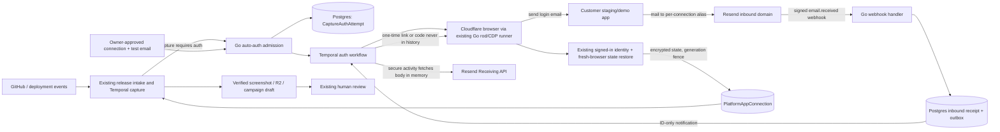

# RFC 007A: Unattended Email Authentication for Authenticated Product Capture

**Project:** Shots / PlaybookMediaLLC  
**Repository:** [`PlaybookMediaLLC/shots`](https://github.com/PlaybookMediaLLC/shots)  
**Target branch:** `develop` (design only; this document does not change the repository)  
**Status:** Proposed — implementation-ready design; security review and live acceptance required  
**Date:** 2026-11-20  
**Owners:** Platform Engineering (auth, browser runtime, security), Product Engineering (connection onboarding, UI, capture integration)  
**Parent:** [`docs/rfcs/007-authenticated-product-capture.md`](https://github.com/PlaybookMediaLLC/shots/blob/develop/docs/rfcs/007-authenticated-product-capture.md)  
**Related:** [`authenticated-capture-runtime-and-recovery.md`](https://github.com/PlaybookMediaLLC/shots/blob/develop/docs/rfcs/authenticated-capture-runtime-and-recovery.md), [`authenticated-release-capture-review.md`](https://github.com/PlaybookMediaLLC/shots/blob/develop/docs/rfcs/authenticated-release-capture-review.md), RFC 003 (claim evidence), RFC 006 (freshness)  
**First provider:** Resend Receiving (`email.received` webhook + Receiving API)  
**Browser:** existing Cloudflare Browser Run integration through Go/rod + CDP  
**Durability:** existing Temporal workers, transactional outbox, Go/Ent/Postgres  
**Scope:** unattended **customer-authorized, first-factor** email magic-link and email-code login for dedicated test accounts; preserve existing human Live View path.

> **Decision in one sentence:** Extend Shots' existing authenticated-capture connection mechanism with an opt-in, deterministic, event-driven email-authentication coordinator. Resend delivers only the authentication message; a tightly scoped browser executor consumes its one-time challenge; existing Shots fresh-browser identity verification, encrypted session persistence, release evidence, and human approval remain mandatory.

---

## 0. Executive decision and non-negotiable constraints

The value is not “AI reads a mailbox.” The value is **a browser workflow that can recover its own access to a specifically authorized staging/demo application without consuming a human's time on every authentication expiry**. Successful authentication is a prerequisite, not proof that a product feature was captured, a release is live, a claim is true, or content may be published.

**Ship v1 only if all conditions below are enforced:**

1. A workspace owner/admin opts in for one immutable application connection, environment, domain set, and dedicated test identity. The address belongs to the customer-created test account; never use a founder's personal or production-admin inbox by default.
2. Only customer-authorized **email-as-first-factor** login is automated. Passwords, TOTP, WebAuthn/passkeys, device-bound credentials, third-party OAuth/SSO handoff, email codes acting as an additional second factor, and CAPTCHA challenges remain a human handoff in v1. An email OTP is not inherently MFA; classify it by the target application's real authentication sequence.
3. Authentication messages and extracted secrets never reach an LLM, browser-agent prompt, Temporal workflow history, audit detail, structured log, analytics event, screenshot, replay, or published document. Never display a one-time link in the Shots UI.
4. Browser sessions are isolated for **one connection and one attempt**, with approved hostnames fixed at allocation. An automated login can use the required form submission, but authenticated capture remains subject to RFC 007's restricted read-only recipe policy.
5. Do not change the existing `CaptureRunner` human connection behavior or attempt to impersonate an end-user `Actor`. Add a service-owned path with its own authorization and audit boundaries; keep **FinishCaptureConnect**'s interactive `ConnectUserID` checks intact.
6. Only a fresh independent browser that restores the exported **approved application** cookies/localStorage and proves the exact configured account can mark a connection `READY`. A login page returning HTTP 200 is never sufficient.
7. Any cancellation, disconnection, workspace revocation, configuration revision, generation mismatch, or expired attempt invalidates the attempt before and after external browser work. Never promote a captured image after a failed fence check.
8. Existing manual Live View sign-in, reviewed uploads, and existing capture-to-campaign workflows remain available when automatic authentication is not configured or fails.

### Goals

- Complete a first-factor magic-link sign-in entirely through a dedicated test address and a remote Cloudflare browser.
- Complete an email **first-factor** one-time-code sign-in through the same mechanism.
- Reauthenticate opted-in connections when a real capture job is parked as `needs_auth`, without producing a second capture pipeline.
- Persist an encrypted, portable session through the existing `sessionstate` module; prove restoration in a distinct browser and verify the account identity.
- Correlate each inbound message to exactly one active, authorized login attempt even under duplicate delivery, out-of-order delivery, worker crashes, and human reconnect races.
- Make errors comprehensible in the UI without leaking authentication materials; measure connection readiness and cost per successful authenticated capture.

### Explicit non-goals

- General mailbox access, personal Gmail integration, inbound customer-support routing, or allowing the agent to inspect arbitrary emails.
- Authentication bypass; handling Google/Microsoft identity-provider challenges without a separately approved integration; password storage; CAPTCHA-solving; TOTP secret storage; passkeys; password resets.
- Automatic production-admin impersonation, destructive actions, autonomous account creation, billing/permissions changes, or customer-data harvesting.
- Replacing Cloudflare, Go/rod, Temporal, Ent, the existing browser state cipher, or the existing Shots review/publication model.
- Treating this feature as proof of end-to-end release-to-marketing success. That remains a separate acceptance gate documented in the existing repository.

### Existing facts: verified against `develop` on 2026-11-20

| Already in Shots | Current implementation / important boundary |
| --- | --- |
| Connection domain | `server/internal/product/capture_connections.go`: `PlatformAppConnection`, `StartCaptureConnect`, `RefreshCaptureConnect`, `FinishCaptureConnect`, `CompleteCaptureConnection`, `RevokeCaptureConnection`; accounts, origins, and allowed login hosts already exist. |
| Browser backend | `server/internal/capture/browser/{provider,runner}.go`: Cloudflare Browser Run REST + CDP; `go-rod` and `coder/websocket`, **not Playwright** in the current Go capture service. Do not build a parallel Playwright login service just for email authentication. |
| Manual sign-in | Admin Live View, ten-minute sign-in window, account check, export, browser close, and independent fresh-browser restore. |
| Session storage | `server/internal/capture/browser/state.go`: approved-host cookies and localStorage only, with known incompatibility for IndexedDB-only/sessionStorage/device-bound credentials. |
| Encryption | `server/internal/capture/sessionstate/sessionstate.go`: AES-GCM `scs1.` envelope, binding `organization + connection + environment + generation`; key rotation support. |
| Persistence and jobs | `server/ent/schema`, `server/platformmigrations/sql`, `server/internal/product/capture_jobs.go`, `server/internal/temporalcapture`, current outbox. |
| Access control | `clients/apps/web/lib/auth/access.ts` and revalidated Go tenant membership. Web clients use `clients/apps/web/lib/backend/sdk.ts`; web never queries Postgres. |
| Existing limits | One active capture/workspace, 90-second capture execution, up to 10 capture steps; saved state normally renews for 24 hours after verified capture but never more than 30 days after last human login. **Do not silently extend** these limits with automation. |
| Real evidence | The existing addendum reports a real Verifier email-OTP sign-in done **by a person** in Cloudflare Live View and a successful separate-browser restore; this does not prove unattended reauthentication exists. |

**Important compatibility decision:** For v1, an automatic email login is treated as a **new, explicitly authorized sign-in event** for the test identity. Record its time separately and require fresh verification. The current `ValidatedAt` field is used by Shots' sliding 30-day authorization cap, so blindly calling its existing completion method and resetting that field would silently defeat RFC 007. **Default: automated auth must not reset the human cap.** Add `LastHumanAuthorizedAt` (backfilled from historical `ValidatedAt`) and `LastAutoAuthenticatedAt`, or equivalent independently audited fields, and make `slidingStateExpiry` use the human timestamp for its absolute cap. Continue to require a human renewal at that cap until security/product explicitly approve a new policy.

---

## 1. End-user experience

### 1.1 Setup flow (workspace owner or admin)

1. Open **Shots → Application connections → [staging/demo connection] → Authentication**.
2. Choose **Email magic link / email login code (first factor)**. Explain that Shots will receive emails addressed **only** to a dedicated test identity and that its browser will click that account's magic link or enter its code.
3. Either register a **new** capture connection using a Shots-assigned receiving address (recommended), or configure an app-supported forwarding route to the assigned address if the target's test identity cannot be changed. In v1, do not mutate a connection's immutable `ExpectedAccount` in place. For an existing connection using a different account, create a new connection and migrate recipes only through owner approval.
4. Display the assigned address, for example `c-<random>@capture-mail.example.com` (placeholder domain; actual domain requires verified MX setup). The owner registers the test account with that exact email in the target application and grants minimal permissions.
5. Specify the **login start page**, the email field's deterministic locator (prefer `data-testid`), submit action, expected challenge type, known sender addresses/domains, approved magic-link hostname(s), and expected signed-in account marker/protected path. Show a plain-language preview; reject arbitrary JavaScript.
6. **Test automatic login**. Show stages (`starting browser`, `requesting login email`, `waiting for email`, `verifying account`, `restoring saved state`, `ready`) without exposing links, codes, raw email contents, or session URLs.
7. Owner must explicitly enable **Automatically reconnect when a capture requires authentication** after the test passes. A successful test by itself does not enable unattended attempts.
8. Keep controls for **Pause automation**, **Reconnect manually**, **Rotate test account**, **Revoke connection**, **See audit history**.

UI copy example: “Use a dedicated demo account. Shots can request and use one-time login emails sent to this address. It won't receive mail from your other accounts or bypass your organization's SSO/MFA policies.”

### 1.2 Automatic recovery at release time

- A deployment/merged release enters the current release → `admitCaptureJob` → Temporal flow.
- The capture job needs a valid connection. When the state is missing, expired, or a restore fails, it transitions to existing `needs_auth` behavior.
- If automatic auth is **enabled, eligible, within the manual-cap policy, and no human connection is active**, a single new auto-auth attempt is admitted. The capture job remains parked. No parallel campaign draft or duplicate screenshot capture is started.
- On success, `CompleteCaptureConnection`-equivalent logic commits verified encrypted state and the existing `resumeCaptureJobs` path wakes eligible parked jobs. The normal capture, evidence, draft, and approval sequence resumes.
- On failure, the attempt records a bounded error code and exposes **Reconnect manually**. Never loop indefinitely trying the customer's login endpoint.

### 1.3 Supported and unsupported login examples

| Login pattern | v1 | Outcome |
| --- | --- | --- |
| Enter known email → click “Send magic link” → email contains app-owned one-time URL | Yes | Open once in original remote-browser context, verify application account. |
| Enter known email → click “Send code” → single six-digit email code | Yes | Enter once into configured OTP fields, verify account. |
| Password → email OTP as a **second** factor | No | Human Live View; do not store password or automate MFA. |
| Google or Microsoft SSO → security challenge | No | Human Live View; no automatic bypass. |
| CAPTCHA, passkey, TOTP, device-bound challenge | No | Human Live View or explicit `NEEDS_AUTH`; no automated solving. |
| App requires IndexedDB-only auth to survive browser restart | Not yet | `SESSION_RESTORE_UNSUPPORTED`; manual connection does not make it portable. |
| Email client link-tracking wrapper or ambiguous multiple links | Only with explicit, reviewed parser | Otherwise `CHALLENGE_AMBIGUOUS`; do not let an LLM choose. |
| User account is not the expected test account | No | `WRONG_ACCOUNT`, revoke candidate state, notify admin. |

---

## 2. System architecture



### 2.1 Trust boundaries

1. **Customer app → Resend**: email content is untrusted, even when delivered through a verified Resend webhook. Resend authenticates the *webhook*, not the underlying email's truthfulness. Validate recipient, expected sender policy, timing, candidate challenge type, approved link destination, and success on the target app.
2. **Resend → Shots backend**: verify the raw webhook before parsing, persist only an opaque receipt and non-sensitive metadata, and acknowledge promptly. The event body does **not** include the email body; retrieve it separately through the Receiving API.
3. **Shots database → Temporal**: workflow inputs and signals contain IDs, state transitions and bounded error codes. They never contain one-time URLs, OTPs, cookies, HTML bodies, bearer URLs, or provider API keys.
4. **Temporal activity → browser**: only an authorized, currently leased activity obtains the challenge. Prefer fetching it and using it in the *same activity process* without returning it as a workflow result. Enforce a bounded lifetime and suppress it from diagnostics.
5. **Browser → external network**: Cloudflare session hostname guardrails remain fixed on allocation, while existing runner-level navigation, method, and origin checks are enforced separately. Host guardrails alone are not equivalent to complete network-layer SSRF controls. Login has a separately approved set of permissible state-changing actions; capture does not inherit them.
6. **Browser → stored session**: export only approved application cookies/localStorage, then verify in a different session. Pass through existing authenticated encryption and authority-generation fencing.
7. **Evidence → publications**: screenshots remain private and subject to redaction and review; no automatic publication follows successful login.

### 2.2 Why reuse Go/rod instead of adding Playwright immediately?

Shots' active capture service is already Go/rod connected to Cloudflare Browser Run. It has tested session lifecycle, guarded navigation, identity checking, session-state export/restore, and release job fences. Implement this feature at those seams. Cloudflare now also supports direct `/script` endpoints and Playwright, but using them for v1 would add a second browser command path with different session/authorization behavior. Treat them as future alternatives only after equivalent isolation, cleanup, and source evidence tests.

### 2.3 Why use Temporal instead of an always-running browser or inbox poller?

A browser is expensive, ephemeral and limited by its idle timeout. Temporal should wait for the *email event*, not tie up a Go goroutine or continuously poll mail. Keep a Cloudflare browser alive only for a short, bounded challenge window (proposed three minutes for v1), then close it. An expired or vanished provider session results in a safe failure and a new explicitly admitted attempt; never assume reattachment will work.

---

## 3. Provider configuration and infrastructure

### 3.1 Resend receiving domain

- Create a **dedicated receiving subdomain**, such as `capture-mail.example.com`, controlled by Shots. This is an example; don't set DNS or ship the domain name until ownership is confirmed.
- In Resend, enable inbound receipt for that subdomain and configure the MX record exactly as instructed by the dashboard. **Do not change the MX for the root domain** if it hosts normal company email.
- Configure a webhook to the production-safe backend endpoint `POST /api/v1/webhooks/resend/capture-auth` for event `email.received` only. Prefer a separate webhook secret from unrelated marketing or transactional-email integrations.
- Generate the webhook signing secret and store it in the backend's secret manager. Store the Resend API key with **read-receiving** scope where the provider supports it; otherwise confine the key to this backend service and account.
- Use a random 128-bit-or-greater local part per **connection and environment**, for example `c-<26-char-random>`, rather than deterministic organization IDs. The local part is not an authorization credential; it is a routing identifier and should be treated as sensitive metadata.
- The admin must create the corresponding application **test identity**. Resend receiving an email for an alias does not create an identity inside that application.
- Store an explicit recipient-to-connection mapping. Never use arbitrary `to` addresses to look up other tenants, and never route across environments.
- Configure size caps: accept email metadata only at the webhook boundary, retrieve max **128 KiB** combined text/HTML body by policy for parsing (provider response may be larger, but reject it), and ignore attachments. Never download email attachments for authentication.
- Put webhooks on a distinct route with raw-body verification. Set `Cache-Control: no-store` on responses, and ensure request/response logging redacts email addresses, headers, and bodies as appropriate.

**Caution:** Resend stores received emails even during webhook outages. The customer needs to understand the retention implications. Verify the provider's available deletion/retention controls before enabling customer production data. The v1 domain should receive *only authentication messages for purpose-built test identities*.

### 3.2 Cloudflare configuration

Reuse `PLATFORM_CAPTURE_CDP_URL` and `PLATFORM_CAPTURE_CDP_TOKEN` already documented in Shots. The REST and CDP service hosts must not be included as **customer app** navigation destinations. When allocating a browser, pass application hosts plus **explicitly reviewed login hosts**, including any authorized auth callback hosts. Cloudflare's current Browser Run guardrails limit HTTP/HTTPS hostnames; they can permit up to 50 `allowedDomains` entries and do not automatically validate every other capability. Keep the stricter v1 Shots host cap and application policy.

For the automated auth browser:

- `keep_alive`: enough for the email challenge, **no more than 5 minutes for v1** even though Cloudflare's documented maximum idle timeout is 20 minutes; choose a provider setting consistent with active commands and retry behavior.
- Browser recording: **disabled** for any challenge or signed-in flow.
- Live View: **not exposed** in unattended mode. If human takeover is required, close the automatic attempt and start a separate authorized interactive connection; never hand out the unattended session's bearer URL.
- Network allowlist: app origin, explicitly approved login host(s), required static/API resources after review. Fail closed if an unapproved destination is needed. Don't add broad identity-provider or CDN wildcards simply to make a test pass.
- No warm authenticated browser shared between runs, users or tenants. Close the initial auth browser after exporting the state; validate state in a new browser; later capture jobs restore it into their own isolated sessions.

### 3.3 Required feature flags and new secrets

| Setting | Suggested default | Meaning |
| --- | --- | --- |
| `PLATFORM_CAPTURE_EMAIL_AUTH_ENABLED` | `false` | Global kill switch; automatically fail back to human connect. |
| `PLATFORM_CAPTURE_EMAIL_AUTH_AUTO_RECONNECT` | `false` | Global permission to start unattended attempts from `needs_auth`. Per-connection opt-in still required. |
| `PLATFORM_CAPTURE_RESEND_API_KEY` | unset | Dedicated Resend Receiving API key; backend/worker only. |
| `PLATFORM_CAPTURE_RESEND_WEBHOOK_SECRET` | unset | Webhook signing secret; backend only, rotation plan required. |
| `PLATFORM_CAPTURE_RESEND_DOMAIN` | unset | Verified receiving domain/subdomain. |
| `PLATFORM_CAPTURE_AUTH_ATTEMPT_TTL` | `3m` | Upper bound on mail challenge waiting. |
| `PLATFORM_CAPTURE_AUTH_MAX_HUMAN_CAP` | existing | Do **not** expand RFC 007's 30-day human authorization cap by default. |
| `PLATFORM_CAPTURE_AUTH_RATE_PER_CONNECTION` | `3/day` | Automatic attempt budget, test invocations included. |
| `PLATFORM_CAPTURE_AUTH_MAX_ACTIVE_GLOBAL` | conservative | Capacity control independent of browser-provider limits. |
| `PLATFORM_CAPTURE_AUTH_MAX_ACTIVE_PER_ORG` | `1` | One active auth flow per organization for v1. |

Configuration must be parsed in the existing server config owner and refuse an enabled feature when provider settings are absent. Do not introduce a second, undocumented `.env` owner. Existing `PLATFORM_CAPTURE_STATE_KEY` encryption remains unchanged.


---

## 4. Persisted data model (Ent + reviewed SQL migrations)

**Do not create new tables for existing concepts.** Keep `PlatformAppConnection`, `CaptureRecipe`, `CaptureJob` and capture attempts as their current owners. Add narrowly scoped records only for inbound email credentials, the auth attempt lifecycle, and webhook deduplication. Use `server/ent/schema` plus `server/platformmigrations/sql`, not Prisma or a web-side database client.

### 4.1 `CaptureEmailAuthConfig` (one row per approved connection)

| Column | Type | Rules |
| --- | --- | --- |
| `id` | CUID/UUID | Stable primary key. |
| `organization_id` | FK/text | Required; every read/write filtered by org. |
| `connection_id` | FK to `PlatformAppConnection` | Unique; same organization. |
| `environment` | enum/string | Copied from immutable connection at creation, checked on every start. |
| `recipient_local_part` | text | Cryptographically random; unique among all environments in receiving domain; never allow customer-defined regexes to broaden matching. |
| `recipient_domain` | text | Verified receiving domain; indexed full address. |
| `method` | `MAGIC_LINK`, `EMAIL_CODE` | One per active config in v1. |
| `login_recipe_version_id` | FK | Immutable, approved deterministic login recipe. |
| `expected_sender_patterns` | JSON array | Exact sender addresses / tightly scoped domains (not unrestricted `*`). |
| `allowed_challenge_hosts` | JSON array | Exact hostnames plus separate, reviewed callback origins. |
| `auto_reconnect_enabled` | bool | `false` until admin opts in after successful test. |
| `status` | `DRAFT`, `VERIFIED`, `PAUSED`, `REVOKED` | `VERIFIED` doesn't imply still authenticated; it means setup passed a test. |
| `revision` | bigint | Optimistic concurrency; changing policy or recipe invalidates prior setup verification. |
| `last_tested_at`, `last_success_at`, `last_failure_code` | nullable | Diagnostics only; no secrets. |
| `created_by`, `approved_by`, `approved_at` | actor IDs/time | Record explicit authorization. |
| `created_at`, `updated_at`, `revoked_at` | timestamptz | Lifecycle. |

`connection_id` and `environment` must match immutable connection authority. The alias may survive retries but not connection revocation. For a changed target user or host policy, issue a **new connection/config** or an explicit revision requiring reapproval. A config in `PAUSED` must not dispatch new automatic attempts. Retain historical metadata according to existing audit retention rules.

### 4.2 `CaptureAuthRecipeVersion` (immutable once approved)

Keep it distinct from a *capture recipe*: login flows legitimately submit forms, whereas capture recipes generally prohibit mutating actions. A login recipe is signed/approved by an admin and is never constructed as executable JavaScript from an LLM.

| Column | Type | Rules |
| --- | --- | --- |
| `id`, `organization_id`, `connection_id`, `version` | identifiers/int | Unique per connection/version, tenant scoped. |
| `recipe_json` | JSON | Versioned, bounded, validated typed steps. |
| `recipe_sha256` | bytes/text | Pin exact approved bytes on attempts. |
| `approved_by`, `approved_at` | actor/time | Human decision required. |
| `created_at` | timestamp | Immutable historical record. |

Example schema (illustrative contract, not code that currently runs):

```json
{
  "schemaVersion": 1,
  "method": "MAGIC_LINK",
  "startUrl": "https://demo.customer.example/login",
  "emailInput": { "testId": "login-email" },
  "requestChallenge": { "testId": "send-magic-link" },
  "challengeConfirmation": { "textContains": "Check your email" },
  "challengeLink": {
    "allowedHosts": ["demo.customer.example", "auth.customer.example"],
    "allowedPaths": ["/auth/callback", "/verify"]
  },
  "expectedRecipient": "configured-connection-email",
  "expectedSignedIn": {
    "protectedPath": "/app",
    "identitySelector": "[data-testid='account-email']"
  },
  "timings": { "pageLoadMs": 15000, "emailWaitMs": 120000 },
  "maxActions": 8
}
```

For `EMAIL_CODE`, replace the `challengeLink` section with a bounded `codeInput` locator and `submitCode` action. The OTP entry adapter must support a single field or explicitly configured segmented fields. Refuse automation if the app requires additional secrets after the email step.

**Validation:** Reject external URLs in steps, invalid/overbroad regexes, unapproved hosts, protocol-relative URLs, credentials embedded in URLs, selectors that resolve to multiple elements, arbitrary JavaScript/CSS execution, network inspection directives, download actions, and auth flows with unbounded loops. The above example uses a fixed path allowlist; a real provider using different paths requires admin approval of the exact pattern.

### 4.3 `CaptureAuthAttempt` (durable, one per login request)

| Column | Type | Rules |
| --- | --- | --- |
| `id` | CUID/UUID | Used as Temporal workflow ID suffix. |
| `organization_id`, `connection_id`, `config_id` | FKs | Enforce same-tenant relations with checked queries. |
| `config_revision`, `recipe_version_id`, `recipe_hash` | int/refs/hash | Pin authority and exact recipe. |
| `connection_generation_at_start` | int | Fencing: changing generation makes attempt stale. |
| `mode` | `TEST`, `AUTO_RECOVER` | Tests cannot bypass owner approval for auto reconnect. |
| `state` | enum | See state machine below. |
| `request_nonce_hash` | binary | Hash of random attempt nonce; never use nonce as an email routing authorization credential. |
| `browser_session_id` | nullable text | Sensitive operational reference, never returned to client. |
| `workflow_id` | text | Stable deterministic `shots-email-auth/<org>/<attempt>`. |
| `email_requested_at`, `email_received_at`, `completed_at` | times | Monotonic chronology based on DB time. |
| `email_receipt_id`, `email_message_id_hash` | nullable | One consumed receipt per attempt; no body/link/code. |
| `deadline_at` | time | Hard TTL, set before sending challenge. |
| `failure_code` | nullable enum | Sanitized stable reason. |
| `attempt_number`, `lease_owner`, `lease_expires_at`, `fence_token` | ints/IDs/times | Crash/retry and stale-worker prevention. |
| `created_by_actor`, `trigger_capture_job_id` | nullable | Human test vs parked job; audit provenance. |
| `created_at`, `updated_at` | timestamps | Auditable lifecycle. |

Partial unique index (SQL syntax to adapt to actual table naming/enum representation):

```sql
CREATE UNIQUE INDEX capture_auth_one_active_per_connection
  ON capture_auth_attempt (connection_id)
  WHERE state IN (
    'ADMITTED', 'BROWSER_STARTING', 'CHALLENGE_REQUESTED',
    'WAITING_FOR_EMAIL', 'EMAIL_MATCHED', 'APPLYING_CHALLENGE',
    'VERIFYING', 'COMMITTING'
  );

CREATE UNIQUE INDEX capture_auth_attempt_workflow_unique
  ON capture_auth_attempt (workflow_id);
```

Also enforce **one active auth flow per org** in the admission service with a transactional advisory/row lock or a Postgres-enforced per-org reservation record. Do not rely only on a Redis semaphore or in-memory mutex. A provider call is outside the DB transaction: allocate session, then reacquire locks and validate current generation/intent before recording it; close allocated sessions if the attempt lost the race.

### 4.4 `CaptureInboundReceipt` (webhook idempotency ledger)

| Column | Type | Rules |
| --- | --- | --- |
| `id` | stable ID | Primary key. |
| `provider` | `RESEND` | v1. |
| `provider_event_id` | text | `svix-id`; unique per provider/webhook. |
| `provider_email_id` | text | Resend email identifier; unique for this receiving service. |
| `recipient_lookup_hash` | text/binary | HMAC of canonical recipient for privacy-preserving correlation; raw recipient only when necessary in tightly scoped config. |
| `attempt_id` | nullable FK | Assigned only after unambiguous correlation. |
| `state` | `RECEIVED`, `ASSIGNED`, `CONSUMED`, `IGNORED`, `FAILED` | Exactly one successful claim. |
| `received_at`, `processed_at`, `expires_at` | timestamps | Retention and cleanup. |
| `failure_code` | nullable | Bounded reason. |

Unique indexes: `(provider, provider_event_id)`, `(provider, provider_email_id)`. A second webhook carrying an already seen email ID must not create another signal or trigger another login. Store only safe metadata; **not raw JSON body, headers with one-time tokens, email text/HTML, or extracted URLs/codes.** Avoid persisting subjects because providers may place codes in subject lines.

### 4.5 Transactional constraints and code ownership

- Use the same account/organization guard as existing capture connection CRUD. A `connection_id` without its `organization_id` scope is never sufficient.
- Check expected connection generation, connect intent ID, config revision, current status, human cap, and cancellation **inside the transaction that updates state**.
- Foreign keys and check constraints reject cross-tenant references; tests must confirm queries also scope by tenant.
- Explicitly decide whether the existing `ConnectIntentID`/`ConnectPhase` fields will be reused or extended. **Recommended:** introduce `ConnectMode` (`HUMAN` vs `EMAIL_AUTOMATED`) with separate service-owned attempt reference and reserve the same connection before allocating a browser. The existing human flow continues to require `ConnectUserID` and `Actor`. Never fake a user ID in background work.
- **Add separate human/automatic authentication timestamps on `PlatformAppConnection`.** Backfill `LastHumanAuthorizedAt` from the historical human-only `ValidatedAt`; update existing manual completion to maintain that value, automatic completion to maintain only `LastAutoAuthenticatedAt`, and `slidingStateExpiry` to enforce the absolute cap against `LastHumanAuthorizedAt`. Test a 29-day-old human approval plus automatic auth and verify it expires on day 30, not day 59.
- Preserve the *single winner* rule: starting a human connection invalidates/closes an active auto attempt; starting auto auth while human connect is open is rejected. A stale auto worker cannot update state after a human reconnect.
- New Ent schema and timestamp fields under `server/ent/schema`, matching SQL migrations under `server/platformmigrations/sql`; regenerate Ent via existing repository tooling. All code must remain compatible with existing Temporal history/version registration.

### 4.6 Example SQL migration sketch (not drop-in production migration)

```sql
-- Illustrative subset. Follow the repository's actual ID types, enum conventions,
-- migration numbering, and Ent schema generation before committing.
CREATE TABLE capture_auth_config (
  id text PRIMARY KEY,
  organization_id text NOT NULL,
  connection_id text NOT NULL UNIQUE,
  recipient_local_part text NOT NULL,
  recipient_domain text NOT NULL,
  method text NOT NULL CHECK (method IN ('MAGIC_LINK','EMAIL_CODE')),
  auto_reconnect_enabled boolean NOT NULL DEFAULT false,
  status text NOT NULL DEFAULT 'DRAFT',
  revision bigint NOT NULL DEFAULT 1,
  approved_by text,
  approved_at timestamptz,
  created_at timestamptz NOT NULL DEFAULT now(),
  updated_at timestamptz NOT NULL DEFAULT now(),
  UNIQUE (recipient_local_part, recipient_domain)
);
CREATE INDEX capture_auth_config_by_org
  ON capture_auth_config (organization_id, connection_id);

CREATE TABLE capture_auth_receipt (
  id text PRIMARY KEY,
  provider text NOT NULL,
  provider_event_id text NOT NULL,
  provider_email_id text NOT NULL,
  attempt_id text,
  state text NOT NULL DEFAULT 'RECEIVED',
  received_at timestamptz NOT NULL DEFAULT now(),
  UNIQUE (provider, provider_event_id),
  UNIQUE (provider, provider_email_id)
);
```

Remaining columns and FKs belong in the real migration. Avoid duplicating the SQL migration and Ent definition by hand; verify generated migrations against the approved design and schema constraints.

---

## 5. Authentication state machine

### 5.1 Attempt states

```text
ADMITTED
  -> BROWSER_STARTING
  -> CHALLENGE_REQUESTED
  -> WAITING_FOR_EMAIL
  -> EMAIL_MATCHED
  -> APPLYING_CHALLENGE
  -> VERIFYING
  -> COMMITTING
  -> SUCCEEDED

Any nonterminal state -> FAILED | EXPIRED | CANCELLED | HUMAN_REQUIRED
```

The main flow is ordered. `EMAIL_MATCHED` is recorded only after a verified webhook receipt has been matched and assigned; it is **not** evidence that the challenge is valid or login succeeded. `SUCCEEDED` is recorded only after a separate-browser identity verification and atomic connection state update. No general-purpose retry reuses a consumed magic link.

### 5.2 Transition owners

| Transition | Authoritative owner | Required preconditions |
| --- | --- | --- |
| `ADMITTED → BROWSER_STARTING` | Go admission + Temporal activity | Feature enabled, config verified, owner opt-in (except explicit test), no human flow, connection generation pinned, rate limit available. |
| `BROWSER_STARTING → CHALLENGE_REQUESTED` | Browser activity | Guarded browser allocated; app login route and locator matched; one authorized email request submitted. |
| `CHALLENGE_REQUESTED → WAITING_FOR_EMAIL` | Activity + DB | Deadline persisted; browser session ID recorded; receipt matchable before submit. |
| `WAITING_FOR_EMAIL → EMAIL_MATCHED` | Webhook receipt matching/DB transaction | Recipient and sender policy, window, single active attempt, dedup, no earlier use. |
| `EMAIL_MATCHED → APPLYING_CHALLENGE` | Temporal activity | Lease/fence obtained; same browser alive; email fetched inside activity; challenge validated. |
| `APPLYING_CHALLENGE → VERIFYING` | Browser executor | Link visited exactly once or OTP submitted exactly once, restricted allowed destinations. |
| `VERIFYING → COMMITTING` | Existing connection completion behavior | Same expected account proved; exported state restored in **new browser**; no extra factor; not cancelled. |
| `COMMITTING → SUCCEEDED` | Go DB transaction | Current generation, mode, config revision, authority, idempotency, and human-cap checks. |
| `* → HUMAN_REQUIRED` | Service | CAPTCHA, SSO/MFA, bad account, unsupported storage state, repeated unknown UI, policy violation. |
| `* → EXPIRED` | Temporal timer/cleanup | Deadline reached even if webhook arrives later. |
| `* → CANCELLED` | Admin/manual connect/revocation | Close browser and discard any candidate token/state. |

### 5.3 Critical race conditions

- **Email arrives before the workflow begins waiting:** persist attempt and `email_requested_at` before submitting the login form; webhook records the receipt and signals the workflow. Workflow startup checks DB for an already-assigned receipt before waiting on a signal. Temporal signal delivery is an optimization, never the only durable source of truth.
- **Two emails in one attempt:** accept only one uniquely matched `provider_email_id`. If more than one plausible challenge arrives, choose neither when timing or sender cannot disambiguate; `CHALLENGE_AMBIGUOUS` and human fallback rather than random selection.
- **Resend retries webhook:** transactionally deduplicate event and email IDs. Respond 2xx after durable insertion; do not signal multiple times.
- **Challenge arrives after deadline:** record `IGNORED_LATE`, do not retrieve or click it.
- **Human clicks Reconnect while auto auth is running:** human flow wins; auto attempt moves to `CANCELLED` and current session is closed. Auth activity must check fence before entering a challenge and before connection commit.
- **Owner revokes workspace/connection while worker is clicking:** revoke first in DB and cancel workflow. Later work must fail the stale-generation check and never persist state/screenshots.
- **Browser dies while email is in transit:** record `BROWSER_LOST` and discard the challenge. Do not click link in a new, unrelated browser automatically when same-context auth may be required.
- **Worker crashes after the one-time link is consumed:** reconcile DB/provider status where possible. Do **not** blindly replay the same challenge. A new attempt requires a new rate-limited login request and idempotency key.
- **Provider email API or webhook outage:** Resend retries the webhook; a bounded reconciliation can list received messages for still-live attempts through the server-only API, deduplicated by email ID. Don't scan arbitrary old mail or hold the browser indefinitely.
- **Another login rotates the account session:** independent fresh-browser check detects failure and marks `SESSION_RESTORE_FAILED` rather than overwriting a known-good connection or claiming a screenshot.

### 5.4 Temporal orchestration sketch

```text
CaptureEmailAuthWorkflow(attemptID, organizationID):
  assert existing DB attempt is admitted and current
  activity: allocate guarded browser and atomically store session reference
  activity: submit configured email challenge exactly once
  activity: mark waiting + verify pending receipt index
  await signal/DB-confirmed receipt OR hard deadline OR cancellation
  if expired/cancelled: close browser; finalize safely
  activity: claim exactly one receipt; fetch and apply challenge in memory
  activity: verify live identity; export application auth state
  activity: close login browser; open fresh session; restore and prove identity
  activity: commit existing connection state through generation-fenced domain API
  activity: close all browser sessions; mark attempt successful
  signal/dispatch existing waiting capture jobs (no second job pipeline)
```

**Do not return** raw email text, magic link, OTP, cookies, HTML, or URL query parameters from any Temporal activity. If a single activity must both read the email and navigate the browser, that's a deliberate security boundary. A workflow should record only the safe outcome `{attemptID, status, failureCode, receiptID}`. Follow Temporal retry policies per activity; classify token-consuming actions as non-retryable after ambiguous completion.

---

## 6. Webhook handling, matching, and challenge retrieval

### 6.1 Event intake: exact protocol

1. Accept only POST and a small capped body (proposed 64 KiB webhook body; email body is fetched separately).
2. Read **raw bytes**. Verify the Resend/Svix signature and timestamp before JSON parsing. Require headers `svix-id`, `svix-timestamp`, and `svix-signature`.
3. Reject invalid signatures with 400/401 and no event processing; never include the raw event in an error log.
4. Ignore unrelated event types. Require `email.received` plus plausible `data.email_id` and `data.to` metadata.
5. Canonicalize addresses conservatively: trim display-name wrappers, lower-case domain, **do not** strip plus-tags or dots indiscriminately (providers differ). Exact alias matching to a configured connection is the default.
6. Insert a deduplicated `CaptureInboundReceipt` in one transaction. Map recipient to one active candidate attempt, without ever trusting `from` as authorization by itself.
7. Commit the receipt + outbox record, return HTTP 204/200 promptly. If Postgres fails before commit, return 5xx so Resend can retry. Retries must remain idempotent.
8. Background Temporal activity retrieves only the assigned received email by `email_id`, verifies recipient and sender again against the **retrieved** message, and parses the challenge in memory.

> **Do not make the Resend webhook POST wait for a browser run.** This decouples provider retries from slow app navigation and keeps email secret handling out of the public HTTP boundary.

### 6.2 Go webhook skeleton using documented Resend Go v4 API

This is a **reference skeleton**, not a drop-in Shots handler: wire it into existing `server/internal/webhooks` route registration, transaction/outbox and error helpers. The current Resend Go package documents `Client.Webhooks.Verify`, `VerifyWebhookOptions`, and `Client.Emails.Receiving.GetWithContext`.

```go
package captureauth

import (
    "encoding/json"
    "io"
    "net/http"

    resend "github.com/resend/resend-go/v4"
)

type inboundEvent struct {
    Type string `json:"type"`
    Data struct {
        EmailID string   `json:"email_id"`
        To      []string `json:"to"`
        From    string   `json:"from"`
    } `json:"data"`
}

// In production, dependencies are injected via the existing handler owner.
func ReceiveWebhook(client *resend.Client, signingSecret string,
    saveReceipt func(*http.Request, inboundEvent, string) error) http.HandlerFunc {
    return func(w http.ResponseWriter, r *http.Request) {
        if r.Method != http.MethodPost { http.Error(w, "method", 405); return }
        body, err := io.ReadAll(io.LimitReader(r.Body, 64*1024+1))
        if err != nil || len(body) > 64*1024 { http.Error(w, "invalid", 400); return }
        err = client.Webhooks.Verify(&resend.VerifyWebhookOptions{
            Payload: string(body),
            WebhookSecret: signingSecret,
            Headers: resend.WebhookHeaders{
                Id: r.Header.Get("svix-id"),
                Timestamp: r.Header.Get("svix-timestamp"),
                Signature: r.Header.Get("svix-signature"),
            },
        })
        if err != nil { http.Error(w, "signature", 401); return }
        var event inboundEvent
        if err := json.Unmarshal(body, &event); err != nil {
            http.Error(w, "invalid", 400); return
        }
        if event.Type != "email.received" { w.WriteHeader(204); return }
        if event.Data.EmailID == "" || len(event.Data.To) == 0 {
            http.Error(w, "invalid", 400); return
        }
        // Persist event ID / email ID with a unique index, correlate under lock,
        // append an outbox item, and commit BEFORE returning 204. Never store body.
        if err := saveReceipt(r, event, r.Header.Get("svix-id")); err != nil {
            http.Error(w, "temporarily unavailable", 503); return
        }
        w.WriteHeader(204)
    }
}
```

The sample intentionally omits tenant resolution, rate limits, database schemas, and backpressure. An implementation must add them as domain-level behavior and tests; don't use the skeleton as an HTTP handler without those protections. In particular, **do not** log `r`, `body`, or the retrieved email.

### 6.3 Recipient and sender correlation policy

To accept a message, require all of the following:

- Recipient local part/domain exactly matches a currently enabled capture-auth config.
- A single matching attempt exists for that connection; it is in `WAITING_FOR_EMAIL` (or safely admits an early event), not revoked, not terminal, and not past the deadline.
- Message receipt time is after the challenge request start, with a small allowed provider clock-skew margin; do not accept a message from an earlier login attempt merely because it reached Resend late.
- Sender meets the configured expected addresses/domains; where available, inspect reliable authentication results from the receiving provider. **Sender matching alone is weak**: From headers are spoofable. Treat the following destination and signed-in account checks as mandatory too.
- Exactly one compatible, parsable first-factor challenge exists; do not guess between links/codes.
- Link destination and all redirects stay inside approved auth/app hosts; one-time link is never fetched outside the controlled browser.
- The resulting application session proves the exact expected account on the protected page.

If the application supports an echoed login-request identifier in email contents, use a random attempt-specific identifier and match it. Most consumer auth APIs don't echo arbitrary IDs; do not assume that feature. In its absence, enforce one in-flight attempt per connection and strict time windows.

### 6.4 Parsing magic links safely

Treat the body as hostile data. An HTML email can contain hidden preheaders, tracking URLs, unrelated promotional links, malformed markup, and prompt-injection instructions. Do **not** ask an LLM to select the link or execute HTML scripts.

1. Fetch received email content from `client.Emails.Receiving.GetWithContext(ctx, emailID)` in a worker with a minimal-scope API key.
2. Check content-size budget; use provider-supplied plain text when possible and a safe HTML parser otherwise. Do not render the HTML.
3. Extract HTTP(S) anchor targets and plain-text URLs with a deterministic parser; normalize Unicode hostnames through standard URL and IDNA handling. Reject embedded credentials, non-HTTPS, unapproved ports, fragments/paths where disallowed, and malformed encodings. Keep the original token-bearing URL **only in memory**; do not normalize/reconstruct token query strings if it could change the challenge.
4. Filter to configured exact hosts/path patterns. Tracking redirectors, shortening services and cross-domain wrappers are **not accepted** unless an administrator explicitly approves a trusted integration and the browser/network policy can enforce every hop.
5. Require exactly one candidate after filtering. If zero: `CHALLENGE_NOT_FOUND`. If multiple plausible candidates: `CHALLENGE_AMBIGUOUS`. Do not choose arbitrarily.
6. Open the URL **once** in the same Cloudflare browser context that requested the link. Do not preflight with `HEAD` or server-side `GET`: this might consume a single-use token.
7. Wait for the expected final approved application origin and identity evidence. Some apps require the original request tab/cookies; if so, keep that context and target the appropriate original page. Never assume a fresh tab/new browser will preserve a PKCE nonce or challenge cookie.
8. Immediately discard the link variable and parsing buffers after browser application; prevent browser network tracing or console output of URL query strings.

### 6.5 Parsing email codes safely

1. Require the configured first-factor code method and a known code length/format (e.g., exactly six digits; not a general regex controlled by customers).
2. Use a provider-specific or reviewed template extractor when possible. Reject emails containing multiple candidate numbers of the same length unless an exact template disambiguates.
3. Never persist or emit the code. Never put it in an LLM prompt, log, error string, or metrics label.
4. Locate the explicitly configured single or segmented OTP input(s). Assert the app is still at the expected challenge screen.
5. Enter code once, submit once, and await the protected app proof. Handle `code expired` as a failure with bounded new-attempt policy, not an infinite resend loop.
6. Do not use the email code if the application had already asked for a password or another factor. Move to human sign-in.

### 6.6 Secret lifetime

The only durable identifier needed to retrieve a received authentication email is the provider's `email_id`. The URL/code should exist only in process memory for the short activity that consumes it. Don't put challenge values in environment variables, task payloads, retry arguments, browser session metadata, CDP debug logs, JSON activity results, or Postgres. If the process crashes after it has begun consuming a challenge, default to **new attempt or human takeover**, not replay.


---

## 7. Browser executor: concrete Go interfaces and algorithms

### 7.1 Extend existing runner instead of introducing a second browser service

Primary files:

- `server/internal/capture/browser/provider.go`: browser allocation, host guardrails, session close.
- `server/internal/capture/browser/runner.go`: attach to provider session for a bounded operation.
- `server/internal/capture/browser/state.go`: existing account assertion/export, approved-host state format.
- `server/internal/product/capture_connections.go`: connection lifecycle, existing `Finish` and `Complete` invariants.
- `server/internal/product/capture_jobs.go`: `needs_auth` job recovery.
- `server/internal/temporalcapture/`: current durable capture workflows.

Add an explicitly named **email authentication executor** to `server/internal/capture/browser/` for type-safe actions, rather than accepting scripts or selectors supplied by an agent at runtime. The browser executor operates on a pinned, admin-approved login recipe and reports only safe states to the caller.

Suggested interface; naming can be adjusted to the repository's conventions:

```go
// All methods are server-side only. Challenge bytes are secrets.
// Never serialize MagicLink or Code as Temporal arguments or results.
type EmailAuthRunner interface {
    // Existing CaptureRunner methods remain reusable:
    Allocate(ctx context.Context, hosts []string, keepAlive time.Duration) (string, error)
    Close(ctx context.Context, sessionID string) error
    Export(ctx context.Context, sessionID string, target Target) (*State, error)
    Verify(ctx context.Context, sessionID string, target Target, state *State) error

    // New bounded methods. Every call enforces the pinned typed recipe.
    RequestEmailChallenge(ctx context.Context, sessionID string,
        target Target, recipe LoginRecipe, recipient string) error
    ApplyMagicLink(ctx context.Context, sessionID string,
        target Target, recipe LoginRecipe, link SecretURL) error
    ApplyEmailCode(ctx context.Context, sessionID string,
        target Target, recipe LoginRecipe, code SecretCode) error
    ProveLiveIdentity(ctx context.Context, sessionID string,
        target Target) error
}
```

`SecretURL` and `SecretCode` should be private, non-JSON-serializable wrappers used only within the security-sensitive activity. For example, their concrete fields can be unexported; implement no `String()` method, and make logging render `<redacted>`. This is defense in depth, not a replacement for correct secrets handling. Never pass them across Temporal workflow serialization or user-visible APIs.

### 7.2 `RequestEmailChallenge`: detailed algorithm

1. Obtain current connection and attempt under the same authorization fence. Verify method, environment, allowed origins, current generation, recipe hash and absence of human takeover.
2. Allocate a browser session through the **existing** Cloudflare provider with fixed approved app/login hostnames. Enforce the same org/session isolation and per-tenant concurrency limits as RFC 007.
3. Connect via Go/rod and navigate to the configured HTTPS login URL. Validate final origin and known page marker.
4. Require exactly one editable email input matching the approved locator; verify it is visible and enabled, not a hidden field.
5. Fill only the configured test email address. Never accept an LLM-provided recipient or inspect a personal inbox.
6. Establish the durable attempt as `CHALLENGE_REQUESTED` before submitting. Persist `email_requested_at`, browser-session reference and deadline, and make the waiting receipt index visible to webhook processing **before** clicking.
7. Click the approved “send link/code” action exactly once. Confirm the known challenge message/screen. Do not retry ambiguous form submits, because they may send multiple emails.
8. Release the attached CDP connection, not the Cloudflare session. Temporal waits for the event without holding a Go worker or a CDP WebSocket.
9. If the app shows a CAPTCHA, SSO wall, password prompt, SMS requirement, unsupported form, or unexpected domain, stop with `HUMAN_REQUIRED`; never ask an LLM to work around it.

### 7.3 `ApplyMagicLink`: detailed algorithm

- Claim the email receipt atomically with a fence token. Fetch content through Resend inside the same worker activity, parse/validate it, and never return the token-bearing URL to the workflow.
- Revalidate org, connection generation, attempt deadline, config revision, active browser session, approved hosts and cancellation immediately before navigation.
- Attach to the **same** Cloudflare session, preferably the same browser context/page that requested the challenge. Do not use a separate `http.Client` to test the URL.
- Navigate exactly once. Recheck the final URL and every observed redirect against the approved login/app policy. Any cross-origin exception requires explicit approval and must remain inside session guardrails.
- Detect and reject success-looking pages that are really “link expired,” “invalid token,” a login screen, or an unrelated account.
- Confirm the configured protected path and expected identity marker; only then proceed to export.
- Suppress URL query strings and fragments in transport errors, CDP diagnostics, traces, screenshots, console-event collection and browser logs. If the browser provider emits them internally, validate provider privacy and retention before launch.

### 7.4 `ApplyEmailCode`: detailed algorithm

- Require the active browser remains on an approved OTP entry page. A late code is invalid if the browser has navigated away or a new request superseded it.
- Match the code with an approved template. Type into configured OTP locator(s), submit once, and wait for the expected protected page. Implement bounded waits, not a `networkidle` assumption for apps with persistent connections.
- Differentiate invalid code, expired code, rate limit, extra factor, wrong account, and provider transport outage.
- Do not let a general browser agent read the code, choose the OTP field, or generate alternate form submissions. If locator drift is substantial, ask for manual intervention and approval of a new recipe version.

### 7.5 Export, restore, prove, and commit

The **existing** `CompleteCaptureConnection` is the source of truth for these invariants. Refactor only as necessary to reuse its inner, tested `export → close → allocate fresh → Verify → Seal → commit → resumeCaptureJobs` sequence from a service-owned automatic attempt.

Required order:

1. Prove identity in the *original* logged-in browser on the configured protected page. Check expected email/account and target environment. Check that no login challenge remains.
2. Export only approved app cookies and localStorage using `browser/state.go`. Do not export SSO provider or Resend cookies. If no portable state exists, report `SESSION_RESTORE_UNSUPPORTED`.
3. Close the original browser **before** completing the connection. Do not leave a signed-in Live View or share link exposed.
4. Allocate an independent guarded browser with **capture** hosts, not wider login hosts, restore state, and call the existing account verification logic. Capture a production/release-ready page only after this succeeds; there is no screenshot as part of login success.
5. Revalidate current config revision, connection generation, **`LastHumanAuthorizedAt` absolute cap**, absence of revocation, work cancellation, and expected identity in the final database transaction. Automated completion **must not write** `LastHumanAuthorizedAt` or reset the 30-day cap through `ValidatedAt`.
6. Seal the state using existing `sessionstate.Keys.Seal` with `Binding{Organization, Connection, Environment, Generation}` and persist via the existing connection owner. Ensure replay/duplicate finalization cannot increase generation twice.
7. Set `READY` only after successful commit, audit with **service actor + authorizing admin identity** and resume parked capture jobs through the existing idempotent mechanism.
8. Close the fresh verification session. Commit no raw challenge or browser provider token to audit/metadata.
9. Maintain RFC 007's state TTL and absolute human authorization cap unless a separate approved change explicitly revises it. At the cap, `HUMAN_REQUIRED`, even if an unattended email attempt could technically authenticate again.

### 7.6 Browser guardrails and authenticated navigation permissions

The auth runner has two explicitly separate modes:

- `AUTHENTICATION`: permits a **tiny, approved** set of POST submissions and click actions solely to request and complete a first-factor email login; follows approved login callbacks. No general site exploration, downloads, permission changes, or off-origin network access.
- `CAPTURE`: inherits existing restricted capture recipe validation, read-only intent, prohibited mutating actions, expected identity/version markers, masks and screenshot quarantine. A login recipe must never be reused as a capture recipe.

Even if the browser is primarily reading a page, a GET can trigger side effects in a poorly designed app. State this limitation plainly in the customer approval UI. Require synthetic demo data and minimal privileges rather than claiming “read-only” is an absolute property of arbitrary web navigation.

### 7.7 Optional navigation-agent support (defer)

If later supporting Stagehand, Browser Use, or a general browser agent, restrict its output to **proposed typed, bounded observations/actions** on allowed pages. It may help locate a moved login input or identify a new page marker but cannot read challenge emails, receive raw links/codes, decide recipients, execute arbitrary scripts, expand host policies, choose an account, or publish a result. Any new login recipe variant requires an admin approval/version step. The v1 critical path should remain deterministic.

---

## 8. Public and internal API contracts

Integrate through the existing Next.js/tRPC platform contracts and Go backend SDK. The paths below are **proposed** and must not conflict with current routes; resolve names against actual route registration. Every admin mutation requires session auth, CSRF safeguards as appropriate, workspace role checks, audit record, rate limits, and Go-side membership revalidation.

| Endpoint | Caller | Contract |
| --- | --- | --- |
| `POST /api/v1/capture-connections/{id}/email-auth` | Admin | Create draft config with generated alias; same-org immutable connection; no automatic attempts yet. |
| `GET /api/v1/capture-connections/{id}/email-auth` | Authorized admin | Return safe config, method, redacted/visible dedicated alias, status, last test and error; no inbox contents. |
| `PUT /api/v1/capture-connections/{id}/email-auth/recipe` | Admin | Create immutable version; require `expectedRevision`, validate typed steps and host policy. |
| `POST /api/v1/capture-connections/{id}/email-auth/test` | Admin | Idempotent test attempt; `202` with attempt ID; no token, code, browser URL. |
| `GET /api/v1/capture-auth-attempts/{attemptId}` | Same-org admin | Safe progress and outcome only, cursor/polling; no secret fields. |
| `POST /api/v1/capture-connections/{id}/email-auth/enable` | Admin | Require last test succeeded for current config/recipe revision and owner approval. |
| `POST /api/v1/capture-connections/{id}/email-auth/pause` | Admin | No new unattended attempts; cancel active one and close browser. |
| `POST /api/v1/capture-auth-attempts/{id}/cancel` | Admin | Idempotent cancellation. |
| `DELETE /api/v1/capture-connections/{id}/email-auth` | Admin | Revoke config and alias routing, cancel attempts; preserve minimal audit record. |
| `POST /api/v1/webhooks/resend/capture-auth` | Resend only | Public, signature-verified raw-body webhook. No user auth, no generic API keys in request. |

### 8.1 Example admin create request

```http
POST /api/v1/capture-connections/con_123/email-auth
Content-Type: application/json
Idempotency-Key: capauth-setup-unique-key

{
  "method": "MAGIC_LINK",
  "expectedRevision": 1,
  "expectedSenderAddresses": ["sign-in@customer.example"],
  "allowedChallengeHosts": ["auth.customer.example", "demo.customer.example"],
  "loginRecipeVersion": 1
}
```

Illustrative safe response:

```json
{
  "configId": "caconf_123",
  "connectionId": "con_123",
  "status": "DRAFT",
  "assignedTestEmail": "c-<random>@capture-mail.example.com",
  "autoReconnectEnabled": false,
  "configurationRevision": 1,
  "nextAction": "Create this identity in the target application, then run a test."
}
```

Do **not** let create mutate the existing `ExpectedAccount` under the hood. The admin must select/create a connection whose expected account is exactly the dedicated test identity. If the existing connection has another account, return a conflict with a guided **create new connection** action.

### 8.2 Example progress response

```json
{
  "id": "caatt_123",
  "connectionId": "con_123",
  "mode": "TEST",
  "state": "WAITING_FOR_EMAIL",
  "startedAt": "2026-11-20T20:00:00Z",
  "deadlineAt": "2026-11-20T20:03:00Z",
  "attemptNumber": 1,
  "safeMessage": "Login email requested. Waiting for the test application's email.",
  "failureCode": null
}
```

No customer-facing response includes `provider_email_id`, browser session IDs, raw message headers, HTML, Resend token, authentication URL, OTP, cookie value, or CDP Live View URL.

### 8.3 Internal domain operations (pseudocode)

```text
CreateEmailAuthConfig(actor, connection, method, recipe)
ApproveEmailAuthRecipe(actor, version, expectedRevision)
AdmitEmailAuthTest(actor, connection, idempotencyKey)
AdmitEmailAuthRecovery(serviceActor, parkedCaptureJob)
IngestVerifiedEmailReceipt(providerEvent)
ClaimChallengeReceipt(attempt, receipt, fence)
FinalizeEmailAuthSuccess(serviceActor, attempt, verifiedState)
FailEmailAuthAttempt(attempt, safeCode, terminal)
CancelEmailAuthAttempt(actorOrService, attempt)
PauseOrRevokeEmailAuth(actor, connection)
```

The internal services accept IDs and a trusted worker-held verified state; they do not accept customer-supplied cookies or token strings. Authorization to **start an automatic attempt** derives from prior explicit admin opt-in and the current `CaptureEmailAuthConfig` revision; it is not inferred from a customer email or the browser's page contents.

### 8.4 UI integration

- Use `clients/apps/web/components/platform-ui` and existing design system components. Don't add raw controls where the repository mandates shared primitives.
- Follow `web/lib/api/contracts`, Zod contracts, web `route(...)` auth rules and `lib/backend/sdk.ts` boundaries.
- Show a non-secret timeline of attempt stages and recommended recovery action.
- For `HUMAN_REQUIRED`, use existing Live View connection flow with *a fresh* intent, never “resume” the unattended browser through a public bearer URL.
- Show the explicit **consent state** (who enabled and when), approved app hosts, login method, and how to revoke.
- Re-authentication attempts should be visible on the capture job timeline but not produce a draft or screenshot until normal capture verification succeeds.

---

## 9. Error taxonomy, retries, and operational recovery

A single generic `login_failed` code is inadequate. Use stable codes that preserve safe operational meaning but carry no provider payload or authentication secret.

| Code | Cause / detectable symptom | Automatic retry? | UX / operator response |
| --- | --- | --- | --- |
| `FEATURE_DISABLED` | Global flag off or config paused | No | Manual Live View remains available. |
| `CONFIG_INCOMPLETE` | Missing alias, approved recipe, sender or allowed hosts | No | Admin completes setup. |
| `AUTH_POLICY_REVIEW_REQUIRED` | Human cap exceeded or unsupported auth policy | No | Human reconnect/approval. |
| `RATE_LIMITED` | Local policy or target app cooldown | Only after bounded cooldown | Show reset window; never hammer login. |
| `BROWSER_UNAVAILABLE` | Cloudflare allocation/connect failed | Up to 2 retries **before** requesting email | Temporary provider failure; optional later retry. |
| `BROWSER_LOST` | Session ended while waiting for email | No replay | New attempt after budget check or manual reconnect. |
| `LOGIN_PAGE_CHANGED` | Approved locators or markers no longer match | No | Require recipe review; no LLM guess. |
| `UNSUPPORTED_FACTOR` | Password/TOTP/passkey/SSO/CAPTCHA/additional OTP | No | Human Live View. |
| `EMAIL_DELIVERY_TIMEOUT` | No correlated mail before deadline | No in same attempt | Inspect test application's email delivery; manual reconnect. |
| `EMAIL_UNMATCHED` | Recipient/sender/time/policy mismatch | No | Alert admin to mismatch without body disclosure. |
| `CHALLENGE_NOT_FOUND` | No approved link/code in message | No | Review email parser configuration. |
| `CHALLENGE_AMBIGUOUS` | More than one plausible challenge | No | Parser revision required. |
| `CHALLENGE_HOST_REFUSED` | Invalid/off-policy URL or redirect | No | Review explicitly; security event. |
| `CHALLENGE_EXPIRED` | App rejects link/code as expired | No same-token replay | New bounded login request / manual. |
| `CHALLENGE_CONSUMED_UNKNOWN` | Worker crashed after token-consuming action | No replay | Reconcile / new attempt. |
| `WRONG_ACCOUNT` | Live browser identity is not expected test account | No | Reject state; admin investigates. |
| `SIGN_IN_INCOMPLETE` | Still on login/OTP screen after apply | No | Human if UI changed. |
| `SESSION_RESTORE_UNSUPPORTED` | IndexedDB/sessionStorage/device binding prevents fresh restore | No | Manual or feature compatibility work; do not claim Ready. |
| `SESSION_RESTORE_FAILED` | Export succeeds but independent restore/identity fails | No | Treat as real auth failure, not email failure. |
| `GENERATION_STALE` | Human, revoke or newer auth replaced this attempt | No | Close old browser; no commit. |
| `PROVIDER_READ_FAILED` | Resend Receiving API temporary outage | Bounded fetch retries while deadline active | After deadline, fail safely. |
| `CANCELLED`, `REVOKED` | Explicit authority withdrawn | No | Finalize and delete ephemeral state. |

Retry policy details:

- **Safe pre-send retries:** browser allocation and transport before the email-request click may retry up to two times with jittered backoff (e.g., 5s, 15s). Re-validate attempt and browser fence before each retry.
- **Email-request click:** assume submission may have succeeded even if response was lost. Do not click again within the same attempt without proof it did not submit. Prefer failing to sending multiple login messages.
- **Received-message retrieval:** transient 429/5xx may retry with exponential backoff while the challenge deadline and browser session remain valid. Never keep a challenge alive past the deadline to accommodate provider retries.
- **Magic-link/OTP submission:** at most once per challenge. Ambiguous transport errors are **not safe** to retry blindly.
- **Fresh-browser verification:** a transient provider allocation failure may retry independently if the original exported state is securely held within a bounded worker context; any crash or handoff requiring secret serialization fails safely. No unencrypted state in Temporal history.
- **Connection persistence:** retry a conflicted DB commit only after re-evaluating all fences; never increment generation or resume jobs twice.
- **Resend webhook delivery:** safe to retry because receipt insertion is idempotent. Return 5xx only for transient failure before durable receipt commit.

### Reconciliation and cleanup tasks

- Scan nonterminal attempts older than their deadline (Temporal timer + DB sweeper as second line of defense).
- Close all known Cloudflare session IDs for terminal/expired/revoked attempts; retry cleanup independently because `Close` may fail transiently. Missing session on deletion is success.
- Alert on orphaned provider sessions, unmatched receipt spikes, repeated wrong-account events and unavailable webhook delivery.
- Purge incidental receipt identifiers and matching metadata according to a defined retention period; recommended **seven days for non-sensitive metadata** pending privacy review. Zero raw message bodies stored by Shots. Provider-side retention is separately controlled by Resend.
- When deleting a workspace or connection, revoke config/alias routing immediately, cancel workflows, and close sessions. Preserve minimal compliance/audit evidence consistent with Shots' existing policies.

---

## 10. Security and privacy threat model

| Threat | Plausible failure | Required mitigation and test |
| --- | --- | --- |
| Forged Resend webhook | Attacker tricks Shots into accepting unrelated email | Verify Svix signature/timestamp on raw bytes, dedup IDs, bounded request body; no work on invalid signature. |
| Sender spoofing | Malicious email claims to be auth provider | Recipient and attempt binding, expected sender, strict approved link host/path, live application identity verification; do not trust From alone. |
| Cross-tenant email injection | Alias for org A paired with org B attempt | FK/org checks, full-address mapping, unique active attempt, tenant-isolation tests. |
| Old email replay | Previous link used for a new login | Attempt-specific window, `email_id` uniqueness, one consume, no after-deadline acceptance. |
| Link-preview consumption | Backend prefetches one-time link | No server-side HEAD/GET; open only once through original browser session. |
| Open redirect / SSRF | Link sends browser to unapproved/internal host | Exact allowlisted hosts, network guardrails, redirect checks, existing public destination restrictions; adversarial tests. |
| Prompt injection in email | Message instructs agent to expose secrets or browse externally | Deterministic parser only; no LLM exposure to inbound message. |
| Prompt injection in app UI | App page instructs navigation agent to change accounts | Type-safe login recipe, approved actions, no LLM secret access, per-action host policy. |
| Exfiltration through logs/traces | Token embedded in URL query, OTP, cookies, headers | No URL-bearing error logs, no screenshots during login, no recordings, audit redaction, secret-type wrappers, CI tests grepping fixture secrets. |
| Unauthorized automation | Customer never consented or consent revoked | Admin approval, per-connection opt-in, strict generation/config fencing, revocation stops outstanding work. |
| Live View bearer link leakage | Anyone with link controls or observes auth session | Auto path never creates/returns Live View URL; human path retains existing short-lived private grant. |
| Race with human reconnect | Old auto worker overwrites fresher human auth state | Shared connection lease, intent/mode check, generation fence before and after network operations. |
| Session replay across orgs | Cookie state decrypted and reused for another tenant | Existing `sessionstate` AAD binding by org/connection/environment/generation; negative tests. |
| Provider/store compromise | Cloudflare/Resend has access to limited challenge context | Minimize data, synthetic account, restrict origins and privileges, review provider retention, document trust in vendor. |
| Excessive login attempts | Target app locks test identity | Rate limits at org/connection/provider, bounded attempts, backoff, manual fallback. |
| MFA/SSO policy bypass | Email challenge is used to defeat enterprise auth control | Explicit scope: first-factor only, test accounts, customer authorization; human handoff for additional factors and SSO. |
| Sensitive screenshot | Auth succeeds but dashboard contains real customer data | Existing private capture quarantine, deterministic masks, reviewer approval, no auto publication. |
| Data retention drift | Authentication events persist beyond need | Short bounded receipt retention, deletion plan, no raw email persistence, provider-specific retention review. |

### 10.1 Security review gates before real customers

- Confirm organizational authorization of the test account and that automatic first-factor login is permitted by the customer's identity-policy owner.
- Independent assessment of Resend webhook verifier, raw-body limit, replay handling and API-key scope.
- Verify Cloudflare guardrails on **each** app and auth host and that no other browser network mechanism can bypass enforced policy. Cloudflare hostname guardrails are a useful defense, not a substitute for all outbound restrictions.
- Confirm the browser provider's behavior for URL-bearing request logs/recordings and disabling session recording. Confirm Shots doesn't log CDP URL data or panic on unexpected frames.
- Audit automatic mode vs human mode transitions under concurrent requests and revoked membership.
- Run the whole login flow with a **synthetic** protected app and a dedicated inbox; no personal data, real customer secrets or personal mailboxes in test fixtures.
- Prove that the human-only 30-day sign-in cap cannot be reset by the new service path without a separate policy decision.
- Confirm emergency kill switch immediately stops new attempts; in-flight workflows are cancelled and provider sessions closed.

### 10.2 Sensitive-data register

| Material | Storage policy | Visibility |
| --- | --- | --- |
| Resend API key, signing secret | Secret manager/env scoped to backend; rotation supported | Backend owner only. |
| Cloudflare provider token | Existing backend config | Existing browser provider only. |
| Test identity email alias | Scoped config, admin UI only; analytics can hash | Owner/admin, service. |
| Auth message metadata | Minimal receipt record, short TTL | Backend only. |
| Email HTML/text | Transient activity memory; never persisted by Shots | Auth parser only. |
| One-time magic URL / code | Transient activity memory; never workflow/DB/logs | Browser executor only. |
| Live View URL | Existing **human** connection only, no persistence | Authorized connecting human only. |
| Browser provider session ID | Server-only attempt metadata, cleanup on terminal | Backend service only. |
| Application session cookies/localStorage | Existing encrypted `scs1.` state, bound to tenant and generation | Capture runner during authorized job only. |
| Screenshots | Private R2/asset pipeline under existing redaction and review policy | Authorized reviewers; publication only after review. |

---

## 11. Test plan: unit, integration, provider, browser E2E, chaos

### 11.1 Local synthetic application fixture

Provide a protected HTTPS fixture with:

- Login route that requests email first factor.
- Separate magic-link and email-code paths.
- Configurable email delay, duplicate deliveries, expired/consumed tokens, wrong recipient/sender, and simulated app rate limits.
- Signed-in identity endpoint/marker that includes account email and tenant/environment.
- Session cookie mode, localStorage mode, IndexedDB-only mode (expected unsupported in v1), and missing-cookie/PKCE nonce mode.
- Redirect and network fixture endpoints for unapproved host, local/metadata address, IPv6, cross-origin iframe, WebSocket, and intentionally malicious HTML email.
- Protected `/app` route and capture marker. A login page with HTTP 200 must not pass.
- Release/deployment version marker so the existing capture path can prove the right revision.

Do not fake identity proof in full-stack tests. An in-memory fake is acceptable for unit parser tests; cross-tenant and fresh-browser acceptance need the real DB/browser boundary.

### 11.2 Unit tests

- Unique, unpredictable alias generation; alias canonicalization preserves meaningful plus tags/dots.
- Recipe schema validation rejects unsupported actions, unapproved hosts, duplicate locators, arbitrary scripts and credentials in URLs.
- Magic link parser: single valid URL, multiple valid URLs, tracking wrapper, malicious path, `javascript:`/`data:` URLs, Unicode hostname lookalikes, encoded slash/backslash, fragments, credentials, whitespace, broken HTML, oversized messages, hidden links.
- OTP parser: exactly one valid code, multiple candidates, code in unrelated footer/phone number, wrong length, expired template, non-digit variants, HTML entities.
- Sender/recipient correlation across case variants and display names; wrong org, wrong env, swapped alias.
- Clock-skew margin; out-of-window email; duplicate email ID; replayed `svix-id`.
- State transitions reject illegal advancement, terminal resurrection, stale config revision or generation.
- Secret wrappers are not JSON serializable and redact `fmt`/logging.
- Rate limit/day and per-org active cap are correct under concurrent transactions.

### 11.3 Go database and Temporal tests

- Admission rejects unauthorized admin, paused or unverified config, and existing human connect intent.
- A webhook arriving **before** the Temporal wait is found through a persisted receipt.
- Duplicate webhook and two concurrent consumers yield one claimed receipt and one connection completion.
- Manual reconnect while email is in transit cancels the auto attempt and prevents its connection commit.
- Revocation during browser navigation prevents session persistence, capture promotion, and parked job resumption.
- Wrong organization/generation AAD cannot decrypt; existing key rotation still works.
- Worker crashes after allocation, email request, webhook insert, token consume, state export, upload, or commit. Each results in one canonical terminal outcome and no secret leak.
- `needs_auth` auto-trigger resumes the **same** parked capture job; no duplicate asset/campaign artifact.
- Human-cap is respected even when the auto workflow succeeds technically.
- Provider failed-close and orphan-session cleanup are retried without losing cancellation fences.

### 11.4 Browser integration tests (real Chrome and Cloudflare)

| Case | Expected proof |
| --- | --- |
| Magic link first factor | Browser A requests email; signed event arrives; Browser A opens once; expected account appears; Browser A closes; Browser B restores authenticated protected route. |
| Email OTP first factor | Code entered into configured field(s); expected account; Browser B independent restore. |
| Same-context nonce/PKCE requirement | Works in original context or fails explicitly; no silent new-browser link click. |
| Sender/link attack | Off-host URL blocked and never visited; no token logged. |
| Wrong app account | Connection never becomes Ready, even if app shows a dashboard. |
| Login screen HTTP 200 | Never counted as authenticated or promotable screenshot. |
| Unsupported IndexedDB session | `SESSION_RESTORE_UNSUPPORTED`; account not Ready. |
| Cloudflare session closes while waiting | `BROWSER_LOST` and safe cleanup, no token replay. |
| Live View human takeover | New human intent invalidates unattended attempt; no leaked URL or stale commit. |
| Valid subsequent capture | After login, existing recipe produces private screenshot with expected release marker, stored asset, normal campaign draft, edit/save/reload. |

**Acceptance evidence must identify** fixture app version, deployment/release revision, workflow ID, attempt ID, non-secret receipt ID, screenshot asset ID, persisted campaign/post IDs, and checks run. Do not include credentials, code values, magic URL, cookies or Live View URLs.

### 11.5 Security/chaos tests

- Resend secret wrong/missing/rotated; invalid signature; old timestamp; mismatched `svix-id`.
- Webhook storm at a single alias; API `429`; delayed provider retry after attempt expiry.
- Concurrent users in same org; different orgs running parallel attempts; session IDs deliberately swapped.
- Customer application redirects to `169.254.169.254`, `127.0.0.1`, IPv6 private ranges, and an attacker-controlled host; block via network/guardrails plus browser policy.
- Browser page contains prompt-injection text requesting the app to navigate to a different domain or expose session tokens; no autonomous compliance.
- Message contains a plausible login link and a second malicious link; parser refuses ambiguity or filters based on exact reviewed policy.
- Simulated operator clicks revoke at each workflow boundary, including while a browser applies the magic link and while state is being committed.
- State cipher wrong tenant, stale generation, and active key rotation.
- Controlled provider outage and database outage, with recovery and dedup.
- Check test logs, telemetry spans, audit payloads and Temporal history for a unique fake secret string; **zero matches** is the required assertion.

---

## 12. Acceptance criteria and ship/no-ship gates

### Gate A: Provider and parser proof

- [ ] Dedicated Resend domain receives an email for a random connection alias; root-domain mail is unaffected.
- [ ] `email.received` webhook is verified on raw bytes, durably deduplicated, then acknowledged.
- [ ] Receiving API retrieves the email body only inside a trusted worker activity.
- [ ] Both magic-link and code parsing operate deterministically; malformed/ambiguous inputs fail safely.
- [ ] No URL/code/email body appears in database, Temporal history, traces, logs, screenshot artifacts or API responses.

### Gate B: Browser authentication proof

- [ ] Real Cloudflare session, not just mocks, requests first-factor mail and authenticates the dedicated fixture identity.
- [ ] Same-context magic link and OTP variants both work for the supported app fixture.
- [ ] Original session is closed; a distinct Cloudflare session restores the approved application state and proves account identity.
- [ ] Wrong account, login page, expired challenge, unsupported storage and unapproved host never produce `READY`.
- [ ] Cloudflare host restrictions, go-rod navigation guardrails and auth/capture action separation remain enforced.

### Gate C: Existing Shots workflow integration

- [ ] Owner test produces the expected safe timeline and requires explicit enablement before unattended recovery.
- [ ] Existing `needs_auth` capture job parks and resumes exactly once after verified reauth.
- [ ] Human reconnect, revoke, generation change and config update fence stale auth attempts.
- [ ] Existing screenshots, assets, campaign drafts, edits and human approval remain unchanged.
- [ ] Manual Live View and manual reviewed-upload fallback work when the feature is disabled.

### Gate D: Security and operational acceptance

- [ ] Independent review covers cross-tenant isolation, webhook spoofing/replay, network egress, secret handling, state encryption and audit.
- [ ] Bounds enforced: one active per org, short TTL, fixed host policy, fixed recipe actions, per-connection rate cap, provider concurrency budget.
- [ ] Terminated/crashed attempts close provider sessions through reconciliation; no persistent orphan leak.
- [ ] Feature flag rollback is exercised against an in-flight attempt.
- [ ] Privacy terms, Resend retention/deletion behavior, and customer authorization text are approved.
- [ ] Real staging demo application (not just fixture) completes repeated auth → capture → draft and save/reload after deployment.

**No-ship conditions:** Any raw auth token in logs/history/assets, inability to prove account identity in a fresh browser, failure to cancel on revocation, cross-tenant receipt/session mix, unknown provider logging of challenge URLs without acceptable retention, automatic bypass of an MFA/SSO requirement, or evidence that a stale automated attempt can replace a more recent human session.

---

## 13. Incremental implementation plan and work ownership

Deliver as small, independently reviewable PRs to `develop`, with no unauthorized deployment or publication. Each PR should preserve existing RFC 007 tests and capture workflows. The order below minimizes the amount of new behavior enabled before its safety controls exist.

| PR / increment | Primary owner | Tasks | Definition of done |
| --- | --- | --- | --- |
| **PR 1 — contracts and policy** | Platform + Product | Document first-factor scope and retention policy, test identity setup, proposed route contracts, typed auth recipe, safe errors, config flags. | Current human flow unchanged; contract and policy tests pass; security review identifies risk owners. |
| **PR 2 — schema and admission** | Go domain + database | New Ent models/migrations, alias generation, config revision, attempt state machine, transactional idempotency/concurrency, audit and permission checks. | Cross-tenant/generation/revocation database tests pass; no provider enabled. |
| **PR 3 — Resend ingress** | Go webhooks | Inbound subdomain ops; raw-body signature verifier; dedup receipt/outbox; Receiving API adapter; deterministic safe email parsing. | Signed fixtures, replay, wrong sender/host, delayed mail and secret-leak tests pass. |
| **PR 4 — browser auth executor** | Go capture/browser | Typed login actions with go-rod, guarded session, magic-link/code apply; same-context continuation; export and independent restore. | Real Chrome fixture tests pass; Cloudflare provider test is run; all browser sessions close. |
| **PR 5 — Temporal integration** | Go Temporal/product | Durable attempt workflow, signal/receipt reconciliation, `needs_auth` admission, service-owned connection completion, fences and cleanup. | Crash/concurrency tests pass; existing `admitCaptureJob`/resume path reused, not duplicated. |
| **PR 6 — admin UI and observability** | Web/product | Create connection with alias, approved recipe, test progress, enable/pause/revoke, safe logs and metrics. | E2E owner flow passes; no secrets in client state or analytics; manual fallback unchanged. |
| **PR 7 — controlled pilot** | Platform + Product + Security | One synthetic app, one staging/demo app, repeated release-to-capture-to-draft, cost and reliability measurements, independent security review. | All gates A–D pass; explicit go/no-go decision and rollback rehearsal. |

**Important repo checks** (from current `AGENTS.md`; run checks relevant to modified files):

```bash
python3 dev/verify-rfcs.py
(cd clients && npm run quality:check)
make -C server check
make e2e
make tenant-isolation
# Regenerate typed API clients when contracts change:
(cd clients && npm run api:generate)
```

These are **commands to run after implementation**. This design draft does not claim they have been run or passed, and the exact environment-dependent tests may need the full local/CI stack.

### 13.1 Proposed ownership map for new code

```text
server/
  internal/
    capture/
      browser/
        email_auth.go                # Typed, deterministic browser actions
        email_auth_test.go
      emailauth/                    # Provider-neutral auth logic and parsing
        recipe.go
        challenge.go
        challenge_test.go
      resendinbound/                # Receiving API adapter; no business policy
        client.go
    product/
      capture_email_auth.go          # Tenant admission/config/fences/audit
      capture_email_auth_test.go
    webhooks/
      resend_capture_auth.go         # Signed webhook + receipt/outbox
    temporalcapture/
      email_auth_workflow.go         # Existing worker registration and tasks
  ent/schema/
    captureemailauthconfig.go
    captureauthattempt.go
    captureinboundreceipt.go
  platformmigrations/sql/
    <next-reviewed-migration>.sql
clients/apps/web/
  lib/api/contracts/
    <capture-email-auth-contract>.ts
  components/workflows/
    <connection-email-auth-panel>.tsx
  test/
    <capture-email-auth>.test.ts
    e2e/<capture-email-auth>.spec.ts
```

Paths are proposed. Search for existing owners, callers and tests first; prefer extending an existing file over duplicating an owner. Any new file must follow nearest `AGENTS.md` rules.

### 13.2 Explicit sequencing of domain work

1. Add **read-only** safe status support so an existing connection can be inspected without exposing secrets.
2. Implement config creation with an assigned alias and no actual login action.
3. Implement manual test with deterministic email magic link on a fixture and a hard retry budget.
4. Prove Go/rod can stay attached to the right Cloudflare context after receiving mail, then prove independent state restoration.
5. Add `EMAIL_CODE` after magic-link tests and separate second-factor rejection.
6. Integrate automated recovery from `needs_auth` only after test mode has passed security gates.
7. Enable UI opt-in/pause and operator metrics before the first real staging pilot.

This ordering avoids expanding the fully automated attack surface before there is a proven one-time challenge parser and browser lifecycle.

---

## 14. Metrics, SLOs, cost and alerting

### 14.1 Primary business/quality metrics

- **Verified unattended reauth rate** = successful first-factor automatic authentications that passed independent fresh-browser identity verification ÷ eligible started attempts. Report failure-code breakdown separately.
- **Useful capture recovery rate** = parked capture jobs that subsequently produced a reviewed, usable screenshot/draft after automatic auth ÷ eligible parked jobs. This is more meaningful than raw login success.
- **Median/P95 auth recovery latency** from attempt admission to verified Ready; also measure email delivery and browser provider time separately.
- **Manual takeover percentage** by app/connection/login method, with no customer identity exposed in metric labels.
- **False-ready count** (target zero), wrong-account acceptance count (target zero), late stale-generation commit count (target zero), leak finding count (target zero).
- **Browser minutes per successful verified recovery**, Resend API calls per attempt, model usage (should be zero on first-factor parsing), retry cost, operator labor.

### 14.2 Initial operational objectives (proposed, not measured SLOs)

- 100% of success responses include a fresh-browser identity verification result.
- 0 unauthorized/manual-cap bypasses, 0 token leaks, 0 cross-tenant session/receipt matches.
- 100% of terminal attempts initiate provider-session close; orphaned sessions reconciled within an operator-defined short window.
- Initial P95 recovery objective: **under three minutes** for fixture apps where email is delivered within two minutes. Establish actual app-specific SLOs from pilot data before making customer claims.
- First production rollout: one org, one test connection, one simultaneous attempt. Raise concurrency only after provider capacity and error rates are understood.

### 14.3 Trace and log design

Allowed structured attributes:

```text
trace_id, attempt_id, org_id_hash, connection_id_hash,
config_revision, recipe_sha256_prefix, provider=cloudflare|resend,
workflow_id, phase, safe_failure_code, duration_ms,
provider_status_class, retry_count, browser_minutes, is_test
```

Forbidden attributes: OTP, magic URL, email HTML/text, raw alias if not required, recipient/message subject, cookies, session storage, browser bearer/viewer URLs, HTTP headers with auth, CDP navigation URL query strings, provider token, extracted screenshot text from login screens.

Alert on growing `WAITING_FOR_EMAIL`/`BROWSER_LOST` populations, webhook 401/5xx spikes, unclosed browser sessions, unusual numbers of login requests on one test identity, and repeated wrong-account findings. Use existing Axiom/OTel infrastructure and Shots activity events; avoid creating a new logging stack.

---

## 15. Rollout, rollback, runbooks, privacy and support

### Rollout

1. **Local fixture only:** feature flags off in shared environments; signed webhook fixture, parser unit tests and DB/Temporal workflow tests.
2. **Cloudflare/Resend test environment:** route mail to a dedicated development inbound domain, use synthetic protected app and actual Resend/Cloudflare services; use restricted credentials and R2 quarantine.
3. **Internal staging pilot:** register one authorized demo application and one test account; verify magic link, OTP, token expiry, provider loss, manual takeover and capture-to-draft. Link evidence to a known deployed commit.
4. **Single customer opt-in:** obtain admin approval, record permitted app/test identity, keep auto-reconnect off until a successful test and security review. Measure failed/successful attempts against manual baseline.
5. **Limited expansion:** increase accounts and login patterns only with explicit engineering, privacy and security gate review. Production-account support is not presumed from a staging success.

### Rollback

- Disable `PLATFORM_CAPTURE_EMAIL_AUTH_AUTO_RECONNECT` immediately: no new `needs_auth` automation starts.
- Disable `PLATFORM_CAPTURE_EMAIL_AUTH_ENABLED` to terminate test flow and gate all new automated attempts.
- Sweep/cancel in-flight attempts and close Cloudflare sessions. Provider webhook endpoint can continue to acknowledge and ignore/expire receipt metadata safely while draining. Do not expose raw messages during rollback.
- Leave **existing verified encrypted sessions** untouched unless an actual credential compromise warrants revocation. Keep manual Live View and manual upload available.
- Re-enable only after an audit of current config revision, authorization, webhook key, provider health and cleanup backlog.

### Operator runbooks

**Webhook healthy, email missing:** Check MX configuration, Resend receiving dashboard, recipient/attempt mapping, app sender delivery and rate limits. Do not inspect arbitrary customer inboxes. If no challenge by TTL, expire attempt and request human action.

**Email received, agent stuck:** Check stage and safe error code; if browser session has died, close/expire it and start a new bounded attempt only with budget and owner consent. Never replay a token-bearing URL from logs, because none should exist there.

**Wrong account:** Reject state and do not capture. Check test identity and app's account-selection behavior with the owner. Require a new connection if `ExpectedAccount` changes.

**Session works in Browser A but not Browser B:** Inspect whether app stores auth in IndexedDB/sessionStorage, binds tokens to device/context, relies on IdP cookies, or revokes session when a new login occurs. Report unsupported compatibility; do not persist a connection as Ready.

**Repeated expired magic links:** Inspect delivery latency, challenge lifetime, browser keep-alive, and whether an upstream link scanner consumed the token. Prefer provider-side test configuration fixes; don't lengthen token TTL or auto-click unapproved URLs without review.

**Security incident:** Flip kill switch, revoke relevant connection generation, cancel workflows, close provider sessions, rotate compromised webhook/API/state keys where appropriate, preserve non-secret incident audit, notify affected customers according to policy, and independently revalidate isolation before re-enabling.

### Privacy and customer messaging

Explain to customers: which dedicated alias is used, which application and test account Shots logs into, where inbound messages are processed (Resend) and browsers run (Cloudflare), what state is stored encrypted by Shots, how long the session may be used, who may pause/revoke it, and why login captures are excluded from published assets. Do not promise “zero external data retention” until vendor data-retention settings have been verified.

---

## 16. Adversarial questions and open decisions

Decide these explicitly during PR 1. Defaults below are designed to avoid silently increasing credential authority.

1. **Does a successful automated email login reset the 30-day human authorization cap?** **No by default.** It can renew the application session within policy but cannot reset human authorization. Revisit only after security/product review and explicit UI disclosure.
2. **Do customer apps require an address on their own corporate email domain?** If yes, a forwarding approach may be needed, but it adds trust and routing complexity. Prefer test identities created directly with assigned aliases for v1.
3. **Do apps strip plus-address tags or block the Resend domain?** Use a unique local part per connection on a dedicated receiving subdomain, not plus-addressing assumptions. An app incompatible with the domain is unsupported until manually integrated.
4. **Are automated emails part of enterprise MFA?** If they follow a password or SSO challenge, the flow is outside v1. Do not label all emailed codes as safe first factor.
5. **Who controls test data?** Customer owns its demo account, least-privilege role and synthetic data. Shots can test only the approved account and routes.
6. **How are login recipes discovered?** Admin-supplied/assisted typed recipes in v1. Model-assisted discovery is a separate, reviewable capability that must not see challenge secrets.
7. **What if account identity is missing from the protected UI?** Do not relax verification. Request a reliable app-owned protected path/identity marker or a custom read-only endpoint approved by the customer.
8. **What if the app relies on IndexedDB?** Existing state exporter will not support it. Add separately designed compatibility work, encrypted state versioning and independent verification rather than claiming email automation solves it.
9. **How are challenge URLs stored by vendors?** Confirm Resend's inbound retention/deletion policy and Cloudflare's potential URL/log retention. Limit vendor access and disable recordings; no claim of zero retention without proof.
10. **Does a successful login prove a release deployed?** No. The subsequent capture must still pin/check the actual deployment identity and relevant feature markers; otherwise label it current-state evidence or fail release proof.
11. **Should we use Cloudflare `/script` instead of rod/CDP?** Not for v1. Browser Run gained `/script` on 2026-11-20, but that does not invalidate Shots' existing Go runner and session checks. Compare as an isolated future ADR only after equivalent safety tests.
12. **How do we handle an auth provider's deep-link or cross-domain callback?** Exact approved auth host/path allowlist, same-session browser handling, explicit provider compatibility test. Never resolve arbitrary redirects in Go or a general LLM.

---

## 17. Implementation agent handoff (copy into an engineering agent)

> Read `AGENTS.md`, `server/README.md`, the actual RFC 007 files, and current source before changing code. Work on a new branch from `develop`; open small PRs against `develop` only. Implement **RFC 007A** as an opt-in extension of the existing Go/rod + Cloudflare Browser Run + Temporal authenticated capture path. Reuse `PlatformAppConnection`, `CompleteCaptureConnection`'s fresh-browser identity verification and `sessionstate` encryption, `capture_jobs` admission/resume, existing web auth, API contracts, outbox and R2. Do not add a parallel screenshot pipeline, general-purpose mailbox agent, Playwright service, or second database owner. Start with policy/contract tests, Ent schema, webhook signature verification, deterministic challenge parser, and explicit test-account UI. Email tokens and bodies must never appear in Temporal history, DB, logs, prompts or UI. Magic links and email first-factor codes only; no password, SSO/MFA, CAPTCHA or bypass. Build an ID-only Temporal wait and a secret-contained challenge-consumption activity. Implement same-session challenge completion, then close and independently restore in a fresh browser. Pin config revision, generation, and connection intent; human reconnect/revoke must always win. Existing 30-day human authorization cap remains enforced unless separately approved. Add exact unit, DB, Temporal, real Chrome, real Cloudflare and E2E tests from this RFC, including cross-tenant and crash chaos cases. Run the repository's required checks; independently review security/performance/chaos/QA; report tests that were not run rather than claiming success. Roll out behind flags and do not deploy or enable for real customers without explicit go/no-go.

---

## 18. Sources and current verified technical references

**Shots' actual code and design (develop branch):**

- [`README.md`](https://github.com/PlaybookMediaLLC/shots/blob/develop/README.md) — current architecture, release-readiness workflow, Go/Ent/Temporal and build conventions.
- [`AGENTS.md`](https://github.com/PlaybookMediaLLC/shots/blob/develop/AGENTS.md) — module owners, API contracts, testing and branch policy.
- [`RFC 007: Authenticated Product Capture`](https://github.com/PlaybookMediaLLC/shots/blob/develop/docs/rfcs/007-authenticated-product-capture.md) — current capture security and product rules.
- [`Managed AI capture and sign-in recovery addendum`](https://github.com/PlaybookMediaLLC/shots/blob/develop/docs/rfcs/authenticated-capture-runtime-and-recovery.md) — real Verifier manual-email-OTP validation, current provider, remaining acceptance gaps.
- [`Authenticated release capture security review`](https://github.com/PlaybookMediaLLC/shots/blob/develop/docs/rfcs/authenticated-release-capture-review.md) — actual implementation status, browser protocol, security fixes, tests and limits.
- [`Release capture investigation, 2026-11-17`](https://github.com/PlaybookMediaLLC/shots/blob/develop/docs/release-capture-investigation-2026-11-17.md) — deferred unattended re-login and updated state lifetime semantics.
- [`server/internal/product/capture_connections.go`](https://github.com/PlaybookMediaLLC/shots/blob/develop/server/internal/product/capture_connections.go) — actual connection lifecycle, actor checks, export/verify/seal/commit sequence.
- [`server/internal/capture/browser/state.go`](https://github.com/PlaybookMediaLLC/shots/blob/develop/server/internal/capture/browser/state.go) — portable authentication state format and identity check.
- [`server/internal/capture/browser/provider.go`](https://github.com/PlaybookMediaLLC/shots/blob/develop/server/internal/capture/browser/provider.go) — Cloudflare provider allocation/CDP implementation.
- [`server/internal/capture/sessionstate/sessionstate.go`](https://github.com/PlaybookMediaLLC/shots/blob/develop/server/internal/capture/sessionstate/sessionstate.go) — authenticated state encryption/tenant binding.

**Vendor/API documentation checked 2026-11-20:**

- [Resend: Receiving emails](https://github.com/resend/resend-skills/blob/main/skills/resend/references/receiving.md) — `email.received`, metadata-only webhooks, retrieving bodies, custom domain/MX setup.
- [Resend: Webhook signing and raw-body verification](https://github.com/resend/resend-skills/blob/main/skills/resend/references/webhooks.md) — Svix headers, signature validation and retry behavior.
- [Resend Go SDK v4 API](https://pkg.go.dev/github.com/resend/resend-go/v4) — `Webhooks.Verify`, `VerifyWebhookOptions`, `Emails.Receiving.GetWithContext` interfaces.
- [Cloudflare Browser Run: CDP](https://developers.cloudflare.com/browser-run/cdp/) — persistent sessions and external clients.
- [Cloudflare Browser Run: Guardrails](https://developers.cloudflare.com/browser-run/features/guardrails/) — fixed host restrictions and limits.
- [Cloudflare Browser Run: Live View](https://developers.cloudflare.com/browser-run/features/live-view/) — bearer-token viewer URLs and link expiry behavior.
- [Cloudflare Browser Run: Custom scripts](https://developers.cloudflare.com/browser-run/script/) — newly introduced `/script` sessions; evaluated but deliberately not used in v1.
- [Temporal: Signals, Updates and Queries](https://docs.temporal.io/encyclopedia/workflow-message-passing) — durable event-driven orchestration semantics.

**Disclosure:** This RFC is a proposed implementation for Shots. It is not a description of Ferndesk's internal source code, and it does not claim that any of the proposed components, API paths, migrations, or tests have been shipped. Product descriptions from competitors are useful references, but the architecture above is grounded primarily in the existing Shots repository and current provider documentation.
