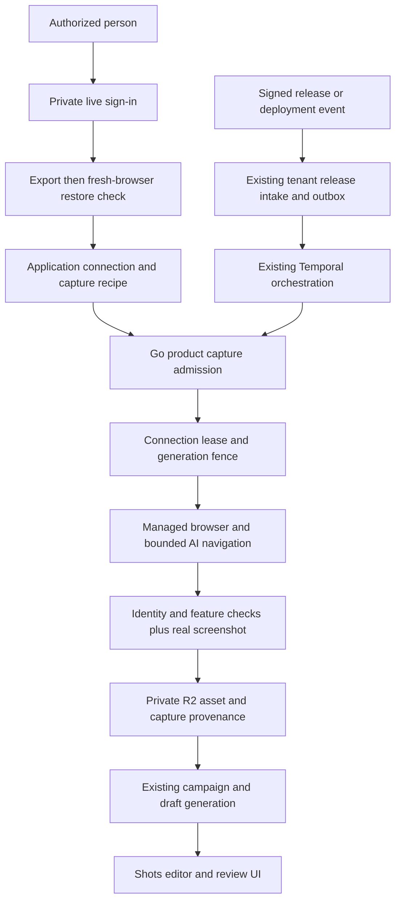

# RFC 007 addendum: Managed AI capture and sign-in recovery

**Status:** Draft; immediate reliability work authorized, provider adoption pending evidence
**Date:** 2026-11-14
**Owners:** Product Engineering and Platform Engineering
**Parent:** [RFC 007](007-authenticated-product-capture.md)
**Reuses:** [RFC 003](003-claim-evidence-and-verification.md), RFC 011/015 release intake, RFC 018 capture history, RFC 029 deployment signals, Go/Ent, Temporal, private R2, existing campaign and editor domains
**Scope:** Finish Verifier capture-to-draft validation; correct sign-in diagnostics and stale live-view recovery; specify the next managed AI agent evaluation.

## 1. Decision and scope

Use managed browser infrastructure now. Evaluate a **managed AI browser agent**,
not just a remote browser that still needs a hand-written navigation script.
Browser Use's hosted Agent API is the first candidate. Browserbase's agent
offering is a comparison candidate. Cloudflare remains the current production
provider until a replacement passes the same evidence, security and recovery
gates. Building and operating a browser fleet is deferred.

The product contract is an objective: “Use this application's saved test
session, find the feature described by this release, demonstrate an allowed
state, and capture it.” The agent inspects the application and selects actions.
Customers should not need to author Playwright code or CSS selectors. Existing
selector-based identity and capture checks remain internal verification tools
for the current implementation; removing that setup requirement is a separate
onboarding improvement, not a claim that it has already shipped.

This assignment authorizes two immediate deliverables:

1. Prove the existing saved Verifier session can produce a genuine screenshot
   and an editable, persisted campaign draft, then repeat capture without a new
   login. Record each acceptance result separately.
2. Distinguish incomplete live sign-in from failed fresh-session restoration,
   and let the connecting person reopen a live view of the same browser without
   discarding an OTP flow or starting a second login.

The RFC does not authorize a new vendor purchase, an unbounded agent budget,
an independent queue, a new campaign model, or automatic publication. A vendor
change follows a measured evaluation and the existing release procedure.

## 2. Evidence and current limits

The inspected source baseline is develop commit
`80eda258e70f0935aedf118b33f593a6313ce606`. Production evidence below comes from
the preceding validation session and must be rechecked before attributing new
results to a deployed revision.

| Observation | Evidence boundary | Implication |
| --- | --- | --- |
| Verifier email OTP sign-in completed inside the real Cloudflare live browser | The application reached `/app`; account identity matched | Email/password is not mandatory; email OTP can work |
| Exported Verifier state restored in a separate real Cloudflare browser | Two cookies, zero local-storage origins, protected route and identity passed | Cookie restoration works for this application; this is not universal SSO proof |
| Shots completed its normal connection check and persisted Ready | UI reload and read-only metadata check agreed | A saved session exists; reuse it before requesting another login |
| The live-view image froze after requesting an email code | Read-only CDP showed the OTP input and enabled verification action; reloading the outer viewer revealed them | Viewer freshness and application authentication are different failure classes |
| Capture-to-draft remains unproved for this connection | No accepted screenshot/campaign/post identifiers yet | Ready is not end-to-end success |
| GitHub App access to Verifier's repository was unavailable | Organization-owner installation change was required | Manual capture proof does not establish real repository-release ingestion |

The exact validation connection is identified in the execution report, not in
customer-facing defaults. Test data must stay in the authorized workspace.
No credentials, cookies, OTPs, live-view URLs or provider tokens belong in this
RFC, test artifacts, analytics, model prompts or campaign copy.

## 3. Existing execution path and owners

| Responsibility | Current owner and source of truth |
| --- | --- |
| Workspace identity, role and permission | Web access layer and Go membership revalidation; never provider metadata |
| Application/environment/session ownership | `PlatformAppConnection` through `server/internal/product/capture_connections.go` |
| Browser allocation, CDP, live view, close | `server/internal/capture/browser/provider.go` and `runner.go` |
| Saved session format | `browser/state.go`: approved application cookies and local storage |
| Encrypted state | `capture/sessionstate`: authenticated encryption bound to organization, connection, environment and generation |
| Capture admission, retries, fencing and asset commit | `server/internal/product/capture_jobs.go` |
| Durable work | `server/internal/temporalcapture`; existing release workflows and transactional outbox |
| Current AI navigation | `product/capture_navigation.go` and `browser/navigation.go`; bounded, observed UI actions |
| Product-page and recipe configuration | Existing product surface and capture recipe owners |
| Campaigns, platform posts and editor handoff | Existing product campaign/draft domains and web editor integrations |
| UI and transport | `components/workflows`, capture Zod contracts, tRPC, backend SDK and Go HTTP adapter |

The existing browser Provider contract already separates allocation,
connection, live view and cleanup. It does **not** implement a hosted agent
task contract. Merely adding another CDP endpoint would not satisfy the AI
navigation requirement. A future agent integration belongs at the existing
capture execution boundary and must return evidence through the same asset
commit path. It must not create a parallel release or campaign pipeline.

## 4. Required product experience

1. An owner selects an application, staging environment and dedicated test
   account, then approves the application's destinations.
2. Shots opens a private browser for that connection. A person can complete
   email OTP, password or supported SSO/MFA there. Shots never claims it can
   bypass Google verification or device-bound authentication.
3. If the view stops updating, the person selects **Refresh sign-in window**.
   Shots obtains a new viewer grant for the same browser and login intent.
   Refreshing the viewer must not navigate or reload the remote application.
4. **I've signed in** triggers verification. A wrong account, incomplete login,
   provider failure and failed session restoration have different messages.
5. Only a successful fresh-browser check makes the saved connection Ready.
6. A release supplies objectives and evidence. The agent discovers and visits
   relevant features, with bounded actions and approved destinations.
7. Shots stores actual screenshots and action provenance, then produces drafts
   whose claims are grounded in the release and observed application.
8. A person reviews, edits and saves. Scheduling or publishing uses the existing
   explicit authorization path and is outside this validation.

## 5. Immediate fix: accurate sign-in diagnostics

Today `ExportConnected` picks an approved-origin page and exports its state.
It does not prove that the expected account is signed in. The completion worker
closes that browser and verifies a new one. Consequently a login that never
finished can look like a cookie-restoration failure.

Extend the existing export boundary to check the expected identity on the
actual live application page before exporting state. Do not navigate away from
an unfinished login, submit forms, retry credentials or infer success from
cookies being present. Inspect approved application tabs; an identity-provider
page is not proof of application login. Preserve the configured identity
selector and account comparison contract. Wrong-account detection remains
distinct from missing identity.

An application may land on a page without the account marker. In that case,
open a temporary tab at the configured protected path in the same browser
context and apply the existing capture network policy and bounded identity
wait. Close only that temporary tab after inspection; preserve the person's
original tab. This also permits account UI to hydrate before classification.
The later independent fresh-browser check remains mandatory.

The completion domain classifies failures by stage:

| Stage | Result | User action |
| --- | --- | --- |
| Live browser has not reached the expected signed-in application | `sign_in_incomplete` | Reconnect and finish sign-in inside the private window |
| Application identity is present but belongs to another account | Existing `wrong_account` | Sign in with the configured test account |
| Live identity succeeded, but a fresh browser cannot restore authentication | `session_restore_failed` | Reconnect; if repeated, investigate unsupported state or application session policy |
| Provider allocation, CDP or transport fails | Existing provider failure code | Retry after browser service recovery; do not blame account credentials |
| Target access violates destination policy | Existing blocked-destination failure | Correct authorized configuration; never relax policy automatically |

Do not change capture-time expired authentication into a restoration error:
normal capture jobs still use their existing `needs_auth` recovery path. Stage
classification belongs to connection completion, not a global error rewrite.
Unexpected infrastructure errors must not default to “sign in again.”

The first fix retains the existing close-and-fresh-verify lifecycle. It does
not promise that pressing Finish early preserves the browser. Recovery of a
stale view is available while sign-in is open. Preserving a live browser after
failed completion would require additional completion/retry semantics and is
not necessary for these two reported defects.

## 6. Immediate fix: recover the same live view

Add one tenant-authorized backend operation to reopen the current sign-in
view. Reuse the existing connect response shape: intent ID, HTTPS live-view
URL and connection expiry. Do not persist the bearer URL.

The operation must:

- Revalidate owner/admin permission and workspace membership.
- Resolve the connection only inside the actor's organization.
- Require the same user who started the sign-in, an OPEN phase, a non-revoked
  connection, a provider session and an unexpired connection deadline.
- Ask the existing provider for a new live-view grant, capped by the remaining
  connection window. Never allocate a browser or replace the intent.
- Recheck the intent/session/phase after the provider call before returning
  the grant, so replacement, completion or revocation cannot return stale access.
- Return only safe errors. Never include the provider response or bearer URL
  in logs, telemetry or query keys.

The UI provides recovery both while the panel is open and after a Shots page
reload. It uses the authenticated mutation to retrieve the current grant;
local/session storage is not used. An expired window requires a new connection
attempt. Refresh cannot extend the login deadline indefinitely.

Keep **Reconnect/Start over** distinct: that action deliberately replaces the
browser and discards unfinished login. Hide or disable finishing controls when
the worker is verifying. Display the actual expiry. Use the existing Button,
error, loading and analytics-exclusion conventions.

This is user-triggered stale-view recovery. No stream heartbeat or frame
freshness signal currently proves that a displayed frame is stale, so the UI
must not claim automatic detection.

## 7. Managed AI agent evaluation

**This section is a design for planned work, not an implemented provider change.**

Browser Use's current documentation distinguishes hosted agent tasks from
standalone browser infrastructure. The hosted agent accepts a natural-language
task and drives the browser. Select that product for evaluation; a browser-only
subscription does not remove the need for an agent. Pin the API generation:
current quickstart uses V4, while older V2/V3 documents describe different
parameters. Do not copy options across versions without testing them.

| Candidate | Why evaluate | Required evidence before adoption |
| --- | --- | --- |
| Browser Use hosted Agent API | Managed objective-driven browser actions; potentially low variable cost | Same saved profile across independent runs; live takeover; full action evidence; private screenshot retrieval; enforceable destination and execution bounds |
| Browserbase agent offering | Managed agent plus browser/session tooling; persistent Contexts | Exact agent API and limits, account plan support, safe integration with existing capture commit and tenant fencing |
| Existing Cloudflare plus Shots agent | Already deployed and proved real email sign-in/restoration | Complete capture-to-draft proof; repaired viewer recovery; measure navigation coverage and failure rate |
| Self-hosted Chromium or commercially licensed Browserless | More runtime control | Deferred until vendor limitations or measured economics justify fleet operations |

A candidate must support the following contract. These are acceptance
requirements, not claims that every vendor currently implements them:

1. Start or resume an isolated application profile mapped to one Shots
   organization, connection, environment and generation.
2. Accept a release objective, starting origin and approved destinations.
3. Bound wall time, model spend and action count; support cancellation and
   terminate abandoned sessions. A prompt is not a network boundary.
4. Report task status, observed URLs and a sanitized action trace.
5. Provide real screenshot bytes or private retrievable objects. Validate
   content type, image decoding, size and integrity before committing an asset.
6. Stop before unapproved mutations and return a human-intervention state for
   MFA, CAPTCHA, missing consent or uncertain destructive actions.
7. Support session deletion/revocation and documented profile persistence.
8. Avoid public recording/share links and unnecessary retention of login data.

Treat all agent output as untrusted. A success string is not proof of identity,
feature arrival, screenshot creation or asset persistence. Preserve independent
verification where possible. Unsupported agent-result schemas fail closed;
do not convert malformed results into a successful campaign.

Begin with the existing read-only Verifier objective. Compare at least two
fresh-browser captures, then a bounded evaluation of repeated runs, expired
authentication, missing feature, stale viewer and provider timeout. Record
completion rate, human interventions, latency and cost per **usable draft**.
Do not select on successful browser startup or a vendor demo alone.

## 8. Economics and build-versus-buy

Prices below were checked on public vendor pages on 2026-11-14. They are not
an invoice, negotiated quote or performance benchmark.

| Option | Published browser cost | Costs still to measure |
| --- | --- | --- |
| Browser Use | $0.06/browser-hour; direct or own-proxy traffic $0.20/GB; home-IP traffic $5/GB | Agent/model charges, traffic, retries, profile behavior and concurrency tier |
| Browserbase Developer | $20/month includes 100 browser-hours, then $0.12/hour | Agent usage, models, proxy overage and plan-specific limits |
| Cloudflare paid browser sessions | 10 browser-hours/month included, then $0.09/hour; concurrency also billed beyond allowance | Existing Workers plan allocation, AI cost and failed-run engineering time |
| Self-hosting | No honest flat price without measured workload | Compute, idle capacity, memory, storage, egress, patching, isolation, on-call and engineering |

Illustration only: 1,000 captures at five browser minutes each consume about
83.3 hours. Browser Use browser time is approximately $5 before traffic and
agent costs. Cloudflare marginal browser time above its included hours is
approximately $6.60 before other charges. Browserbase Developer includes those
hours for its $20 subscription. These figures do not establish which completes
the task cheapest; additional login time, failed attempts and model work count.

Use this accounting model:

`cost per accepted draft = (browser + agent/model + traffic + storage + failed attempts + attributable operations) / accepted drafts`

The current decision favors managed service because building session hosting,
streaming, isolation and cleanup has an engineering cost even at low usage.
Reconsider self-hosting only when measured cost or an unmet security/product
requirement outweighs that cost. Do not implement a speculative fleet now.

## 9. Authentication, tenancy and navigation safety

Saved sessions remain credentials. Encrypt local state with the existing
binding. A future provider-managed profile is also a credential-bearing
resource: store an opaque tenant-owned reference, enforce exclusive mutation,
delete it on revocation, and verify the provider's retention and access policy.
Never share a profile between organizations or unrelated applications.

Supported authentication is determined by the application and provider. Email
OTP has worked for Verifier. Passwords, SSO, passkeys and device-bound sessions
must each be tested; no provider is a guarantee of Google sign-in acceptance.
Application session expiry remains authoritative even if a vendor profile
itself does not expire.

For future unattended sign-in, prefer a dedicated least-privilege test account
and explicit customer authorization. A mailbox connector would need narrow
mailbox/sender/domain/time-window scoping, encrypted credential references,
OTP redaction and rejection of unrelated messages. Personal mailbox access is
not a default product requirement. Do not build that connector in this fix.

Enforce destination policy outside the model: block private/link-local/metadata
addresses, unauthorized redirects, unapproved subresources and navigation to
unrelated origins. Verify how a hosted agent enforces these rules, including
DNS resolution and rebindings; a domain-list prompt is insufficient. Never
forward a broad identity-provider session into campaigns or model context.

Treat application page text as untrusted data. Instructions embedded in a page
cannot widen destination policy, disclose secrets, publish, delete, purchase,
send email or change account settings. The Verifier scenario is read-only:
opening Analytics is allowed; starting verification jobs or changing billing
is not.

## 10. Durable execution and evidence

Keep the existing outbox and Temporal workflows authoritative. A provider task
ID is an execution receipt, not a release identity. Existing release event
deduplication and capture admission remain in force. If task creation times out
after possible acceptance, reconcile the provider task before starting another
billable run; do not assume provider POST requests are idempotent.

Preserve lease/generation fencing when a capture completes after reconnect,
revocation or cancellation. A late screenshot cannot attach itself to a newer
connection generation or another tenant's campaign. Retain existing workflow
registrations for replay; schema or workflow changes need their normal gates.

For each accepted asset, retain the release or explicit manual-test context,
application/environment, recipe revision, capture run, provider session/task
reference, feature objective, sanitized final URL, action summary, timestamp,
dimensions, original object key and campaign/post associations. Private asset
links must remain authorized and expire according to the existing storage
contract. Never store bearer viewer URLs as provenance.

Original captures are immutable evidence. Editor changes create derivatives
with lineage; editing does not overwrite the original. Campaign generation
must preserve user edits when regenerating another post, remain draft-only,
and label missing or partially verified feature coverage honestly.

## 11. Observability and recovery

Use existing structured logs, audit events and persisted job phases. Correlate
release event, capture job, provider session, asset, campaign and post IDs where
those relationships exist. Do not invent IDs when an earlier stage failed.

Distinguish queued, browser starting, authentication check, navigation,
screenshot capture, storage, campaign generation, awaiting review, partial and
failed outcomes. Browser availability, incomplete login, wrong account,
restoration failure, navigation failure and storage failure need separate
actionable messages. A campaign is not complete while required capture or
storage work is unresolved.

Refresh-live-view events may record the connection and actor, never the grant.
Model prompts and DOM dumps are not routine logs. Diagnostic evidence should
use booleans, safe codes, timings and opaque identifiers; screenshots and
recordings follow tenant media access rules and masking requirements.

## 12. Verification matrix

| Layer | Required cases | Proof |
| --- | --- | --- |
| Browser unit/real local Chromium | Missing identity; wrong identity; expected identity; multiple approved tabs; provider disconnect | Classified error or valid state; no fabricated success |
| Domain with real test database | Fresh restore failure differs from incomplete login; Ready only after success; reconnect/revoke fences | Persisted status, failure code, generation and encrypted state |
| Live-view domain | Same user/same tenant; wrong actor/tenant; expired/revoked/finishing; replacement during provider call | No unauthorized URL; same session and intent on success; no allocation or deadline extension |
| Transport/contracts | Valid request; invalid ID; permission rejection; response validation | Existing SDK/tRPC/HTTP conventions, no token in errors |
| UI browser journey | Open, refresh, reload Shots and resume, finish, readable failure, reconnect | Existing authenticated production-image E2E lane |
| Real Cloudflare | Reopen same live browser; signed-in session export and independent restore | Actual provider session and application identity; mocks do not count |
| Capture-to-draft | AI reaches Analytics; screenshot stored; campaign/post attachment; edit/save/reload | UI plus persisted artifact identifiers |
| Repeatability | Second capture with saved session, no new OTP | New run/asset, same valid connection generation |
| Failure/recovery | Expired auth, absent feature, timeout, storage failure, duplicate release, interrupted job | Honest failed/partial state and bounded recovery without duplicate campaign |

Run focused Go/browser/domain tests, `make -C server check`, client quality
checks, API generation when contracts change, and the relevant E2E suite.
Report skipped integration tests as unavailable, not passed. Apply independent
structure, performance, chaos, QA and lean review after verification.

## 13. Verifier production acceptance procedure

1. Confirm actual production image SHA and the saved connection's Ready state.
2. Register an isolated product-page fixture for Verifier Analytics using the
   supported UI. Configure a read-only objective and masking of account details.
3. Run capture from Shots. Observe durable progress and AI navigation from an
   application entry page to Analytics; direct root capture alone is inadequate.
4. Open the stored screenshot, verify the target UI state, provenance and
   successful image retrieval. Reject login, loading or error-page captures.
5. Create the campaign/draft through the existing handoff. Verify release or
   explicit manual-test association, platform copy and real image attachment.
6. Edit content and an image derivative, save and reload. Confirm persistence
   and preservation of original capture evidence.
7. Run a second capture without signing in again and record its artifacts.
8. Test diagnostic and viewer fixes against their verified deployed revision.
9. When GitHub App repository access is available, run the real release trigger
   and duplicate delivery test. Until then mark this gate externally blocked.

Never publish or schedule the validation posts. Do not describe a manual
current-state fixture as proof of a release or of newly shipped capabilities.

## 14. Delivery, rollout and rollback

Keep the changes in a focused branch from develop. The immediate fix requires
no new queue, dependency, table or provider account. Changes reach the browser
export boundary, connection domain, transport, SDK/contracts and connection UI,
with existing test files extended where possible.

After local verification and independent review, open a PR to develop. These
changes touch authentication, so require the associated integration/browser
validation and required checks before merge. Promote only with the established
develop-to-main merge-commit release. Monitor deployment to a terminal state
and verify deployed image tags before retesting.

Rollback uses the documented application deployment/release recovery path.
Because the fix adds safe failure classifications and a recovery action without
changing encrypted state format, existing saved sessions remain readable.
Do not revoke working customer sessions merely to roll back UI behavior.

Maintain an execution ledger with defect, reproduction, root cause, files,
tests, local result, PR/SHA, deployment and production retest. Initial entries:

| ID | Severity | Defect | Initial state |
| --- | --- | --- | --- |
| RC-013 | P2 | Incomplete live login and fresh-session restore failure are conflated | Reproduced; correction pending |
| RC-014 | P2 | Stale live view has no same-session recovery action in Shots | Reproduced; correction pending |
| Acceptance gap | P1 outcome gate | This saved Verifier connection has not yet produced a verified editable campaign draft | Production test pending |

## 15. Deferred self-hosting design and licensing

**This section is a design for planned work, not an implemented service.**

If future evidence justifies self-hosting, keep Go/Temporal as the control
plane and run short-lived isolated Chromium workers behind the existing
provider boundary. Require per-tenant process isolation, constrained egress,
private authenticated CDP, short-lived live-view grants, strict resource
limits, lease-based capacity, browser version pinning, cleanup on cancellation
and crash, encrypted state, and load/chaos tests. Do not expose raw remote
debugging ports publicly or share a user-data directory across tenants.

Reuse existing job admission rather than adding another business queue. The
fleet would handle only browser capacity and lifecycle. A hosted AI agent could
still be separate from the browser runtime; verify compatibility before assuming
the agent accepts arbitrary CDP sessions.

Browserless's public repository uses SSPL/commercial licensing. Public source
availability is not permission to embed it in a proprietary hosted product
under arbitrary terms. Resolve the commercial or license-compliance path before
copying code. A new implementation using standard browser APIs would still need
all operational and security work above. No Browserless code is copied by this
RFC or the immediate fixes.

## 16. References and unresolved decisions

- [Browser Use hosted agents versus browser infrastructure](https://docs.browser-use.com/cloud/quickstart)
- [Browser Use pricing](https://browser-use.com/pricing)
- [Browserbase pricing](https://www.browserbase.com/pricing)
- [Browserbase persistent Contexts](https://docs.browserbase.com/platform/browser/core-features/contexts)
- [Cloudflare Browser Run pricing](https://developers.cloudflare.com/browser-run/pricing/)
- [Browserless source and license](https://github.com/browserless/browserless)
- [Existing authenticated capture security review](authenticated-release-capture-review.md)
- [Release automation](../release-automation.md)
- [Branching and releases](../branching-and-releases.md)

Before adopting a managed agent, resolve its exact API version, supported
guardrails, profile ownership/deletion, private media retrieval, recording
retention, cancellation guarantees and complete run cost. No current vendor
has passed these Shots-specific gates in this RFC. The immediate Verifier and
sign-in work proceeds independently of that decision.
